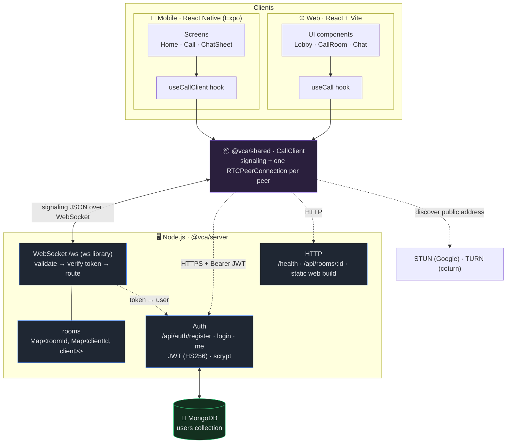
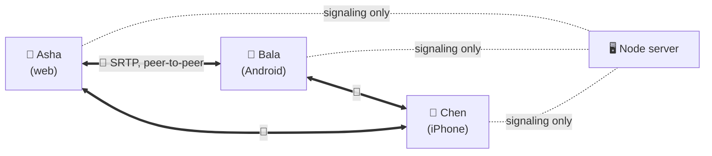
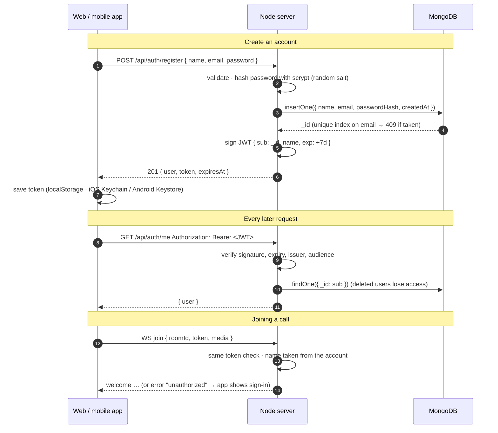
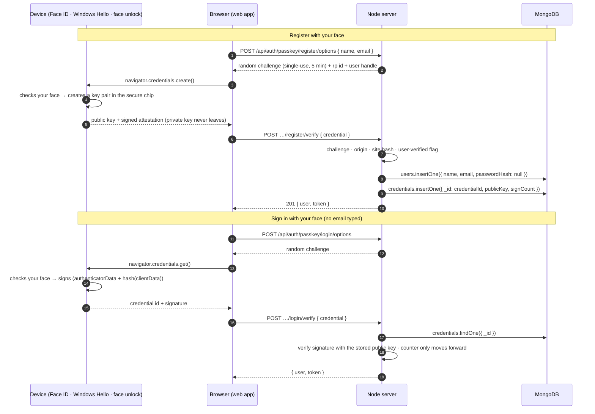
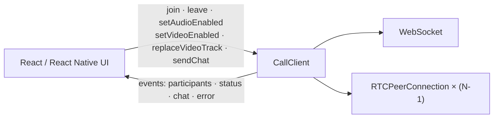
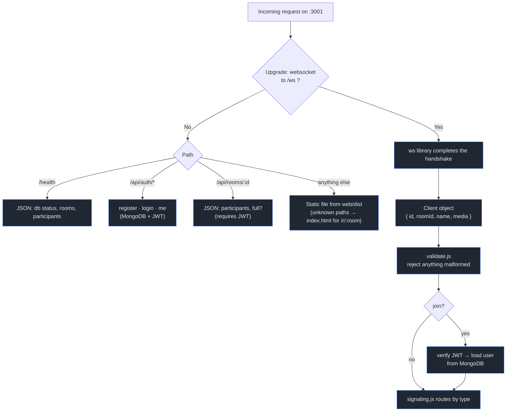
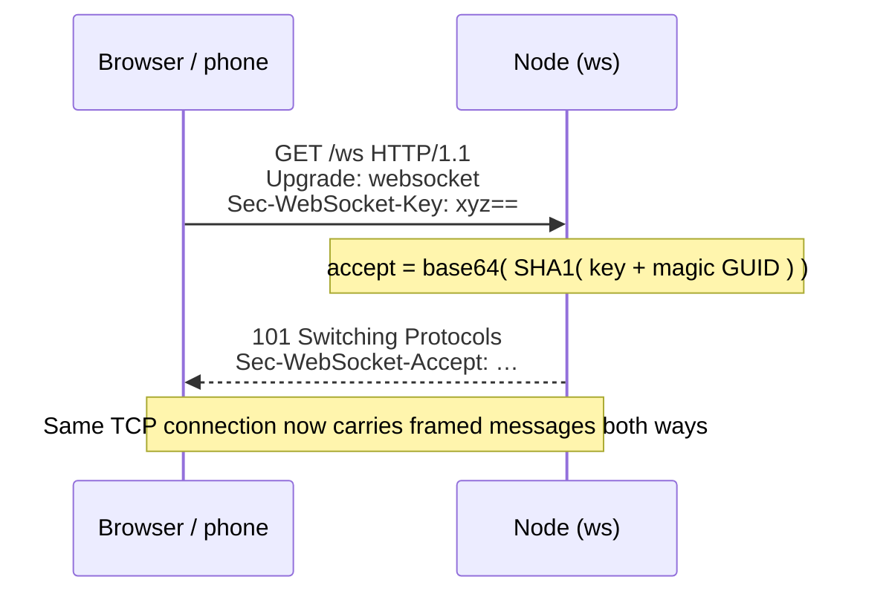
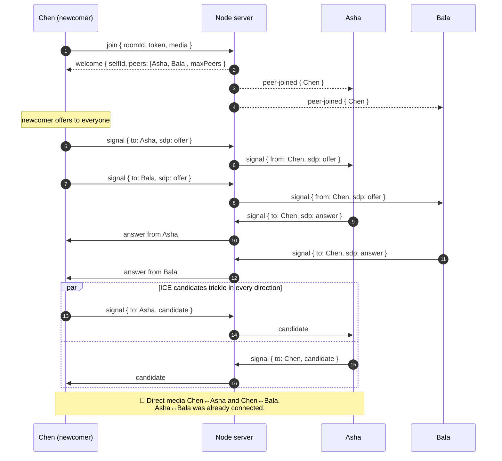
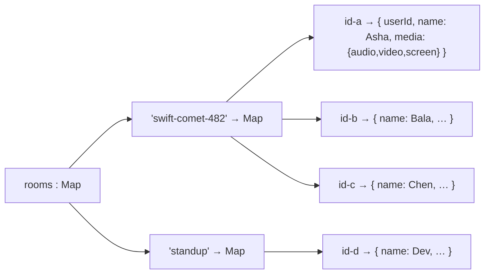
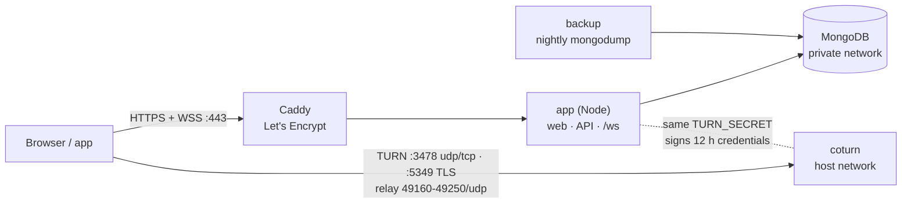

# Architecture: how WebSocket, Node.js, MongoDB and WebRTC work together

This document explains the moving parts of Huddle: accounts (MongoDB + JWT),
the Node.js server, the WebSocket signaling protocol, the shared call engine
used by both React and React Native, and how a group of devices ends up
streaming video directly to each other.

> **The one idea to hold onto:** the Node server is only a *matchmaker*. It helps
> devices find each other and exchange connection details. Once they're
> connected, **audio and video flow directly between the devices**. The server
> never sees a single video frame.

---

## 1. System overview



And the media itself, for a 3-person call:



This is a **mesh**: every participant has one direct connection to every other
participant. It's simple and needs no media server, but each device uploads its
video once *per other person*, which is why rooms are capped at 6. An SFU (Step 3)
removes that limit.

| Path | Carries | Goes through the server? |
|------|---------|--------------------------|
| **Signaling** (WebSocket) | small JSON: join, offers, answers, ICE candidates, chat, mute state | ✅ yes |
| **Media** (WebRTC) | audio, video, screen share (encrypted) | ❌ no, device ↔ device |

---

## 2. Accounts and sign-in (MongoDB + JWT)



**The `users` collection**

```js
{
  _id: ObjectId,            // becomes the JWT "sub" and PeerInfo.userId
  name: "Asha Verma",
  email: "asha@example.com", // stored lower-cased; unique index "email_unique"
  passwordHash: "scrypt$16384$8$1$<salt>$<hash>",
  tokenVersion: 0,           // in every JWT as "tv"; +1 on password change
  createdAt: Date, updatedAt: Date, lastLoginAt: Date | null
}
```

**Why these choices**

| Decision | Reason |
|---|---|
| **scrypt** (Node built-in) for passwords | memory-hard like bcrypt/argon2, no native module to compile on Windows/macOS; parameters are stored with each hash so they can be raised later |
| **JWT (HS256)** with fixed algorithm | stateless: the WebSocket can authenticate without a session store; pinning the algorithm rules out `alg: none` and algorithm-confusion attacks |
| Token checked against MongoDB on use | a deleted account stops working immediately, not when its token expires |
| Same error for wrong password and unknown email (plus a dummy hash check) | attackers can't discover which emails have accounts |
| Rate limits: 10 logins / 15 min per email, 50 per IP, 20 sign-ups / hour per IP | slows password guessing; set `TRUST_PROXY=true` behind a proxy so the real IP is used |
| Name comes from the token, not the client | nobody can join a call pretending to be someone else |
| Mobile token in **expo-secure-store** | encrypted by the OS keychain/keystore instead of plain storage |

**Changing your password signs out other devices.** Every token carries the
user's `tokenVersion` as `tv`. A password change increments it and returns a
fresh token to the device that made the change, so every older token fails the
check on its next API call or join.

Editing the profile (`PATCH /api/auth/me`) also returns a fresh token, because
the name inside it changed. Changing the email needs the current password, so a
borrowed unlocked laptop can't take over the account.

**Known trade-offs:** there is no refresh token yet (sign in again after 7 days),
and signing out deletes the token on the device without revoking it on the
server (changing the password does revoke it).

---

### Face sign-in (passkeys / WebAuthn)



The face itself is never seen by the app or the server: the device's own
biometric check unlocks its private key. The verifier is
`server/src/auth/webauthn.js` (CBOR + COSE parsing and ES256 / EdDSA / RS256
signature checks with `node:crypto`), and the routes are in
`server/src/auth/faceAuth.js`.

The **mobile app** uses a simpler scheme that needs no website domain: the
server issues the phone a random key (`POST /api/auth/device/register`), the app
stores it in the Keychain / Keystore with `requireAuthentication`, and the OS
releases it only after Face ID / face unlock / fingerprint. The server keeps a
SHA-256 of it and compares in constant time on `POST /api/auth/device/login`.

```js
// credentials collection (one per device)
{ _id: "<credential id>", userId, kind: "passkey" | "device", name: "Chrome on Windows",
  publicKey: { kty: "EC", crv: "P-256", x, y }, alg: -7, signCount, userHandle, transports, synced,   // passkeys
  secretHash,                                                                                      // app keys
  createdAt, lastUsedAt }
```

---

## 3. The shared call engine (`shared/src/CallClient.ts`)

Both React apps use **the same** `CallClient`. The UI never touches WebRTC; it
calls a small API and re-renders on events:



It only uses standard WebRTC globals. On mobile, `react-native-webrtc`'s
`registerGlobals()` (in `mobile/index.js`) installs `RTCPeerConnection`,
`MediaStream` and `navigator.mediaDevices`, so the same code runs unchanged.

Key behaviors:

- **Who calls whom:** the *newcomer* sends an offer to everyone already in the
  room; existing members only answer. Two people never send offers to each other
  at the same moment ("glare").
- **Fixed audio and video slots:** every connection negotiates one audio and one
  video slot up front. Screen sharing and flipping the camera then just swap the
  outgoing track with `sender.replaceTrack()`, which needs **no renegotiation**.
- **Early ICE candidates** that arrive before the offer/answer are queued, then
  applied once it lands.
- **ICE restart:** if a connection fails, the side that made the original offer
  retries with a fresh `iceRestart` offer.
- **Reconnect:** if the WebSocket drops, the client tears down its peers and
  rejoins with backoff (1s, 2s, 4s, 8s), up to 5 times.

---

## 4. What the Node.js server does

`server/src/app.js` runs one Node process that does two jobs on one port (3001):



Node fits this job well because it is **single-threaded and event-driven**: one
process can hold thousands of idle WebSocket connections cheaply and wakes up
only when a message arrives.

Safety built into the server:

| Concern | How it's handled |
|---|---|
| Who are you? | `join` must carry a valid JWT; the name shown to others comes from the account |
| Malformed / hostile input | every message is parsed and checked in `validate.js` (types, lengths, room-id pattern); HTTP bodies are capped at 16 KB |
| Huge messages | `maxPayload` 64 KB; SDP ≤ 32 KB; chat ≤ 1000 chars |
| Chat spam | max 5 messages per 5 s per person, extras dropped |
| Signals to the wrong person | relayed only to the `to` peer, and only within the same room |
| Dead connections | ping every 30 s; no pong → terminated → `peer-left` sent |
| Overcrowding | `MAX_PEERS` cap → `room-full` error |
| Cross-site sockets | optional `ALLOWED_ORIGINS` allow-list (native apps send no Origin) |

### How a WebSocket works under the hood

The `ws` library handles this for us (Step 1 implemented it by hand; see git
history). A WebSocket starts as a normal HTTP request and is then *upgraded*:



After that, data travels in small **frames** (an opcode such as text, close or
ping, a length, and a payload that is masked when it comes from the client). Our
messages are text frames containing JSON.

---

## 5. Joining a group call

What happens when Chen joins a room where Asha and Bala are already talking:



Leaving is the reverse: the socket closes (or sends `leave`), the server
broadcasts `peer-left`, and everyone closes that one peer connection.

---

## 6. Server state

Who is in which room lives in memory. Accounts and chat messages are stored in MongoDB:

```js
// messages collection
{ _id, roomId: "standup", userId, name: "Asha Verma", text, createdAt: Date }
// indexes: { roomId: 1, createdAt: -1 } for paging,
//          TTL on createdAt (CHAT_RETENTION_DAYS, default 30) so old messages delete themselves
```

Two more collections feed the Teams-style tabs:

```js
// calls: written when you leave a meeting (Calls tab), deleted after 90 days
{ userId, roomId, startedAt, endedAt, with: ["Bala Krishnan", "Chen Li"] }
// room_members: rooms you joined or wrote in (Chat tab, "Happening now")
{ userId, roomId, lastActiveAt }   // unique on (userId, roomId)
```

The `welcome` message carries the room's last 50 messages, and older pages come
from `GET /api/rooms/:id/messages?before=<ts>`. A message is saved first and only
then broadcast, so everyone sees exactly what was stored. Without `MONGODB_URI`, an
in-memory store with the same interface is used (500 messages per room).

In-memory call state:



Rooms are created on first join and deleted when the last person leaves. To run
**several server instances** behind a load balancer later, this map would move to
Redis (pub/sub) so instances can relay to each other.

---

## 7. Signaling protocol

Defined once in `shared/src/protocol.ts` and validated by `server/src/validate.js`.

**Client → server**

| Message | Purpose |
|---|---|
| `{ type:"join", roomId, token, media }` | enter a room; `token` is your JWT |
| `{ type:"signal", to, data }` | send `data` (SDP offer/answer or ICE candidate) to one peer |
| `{ type:"chat", text }` | message everyone in the room |
| `{ type:"media-state", media }` | announce mic / camera / screen-share state |
| `{ type:"leave" }` | leave politely (closing the socket also works) |

**Server → client**

| Message | Purpose |
|---|---|
| `{ type:"welcome", selfId, roomId, peers[], maxPeers, history[], historyHasMore }` | you're in; here's who is already here and the recent chat |
| `{ type:"peer-joined", peer }` | someone new arrived (they'll send you an offer) |
| `{ type:"peer-left", id }` | someone left |
| `{ type:"signal", from, data }` | WebRTC data from a peer |
| `{ type:"chat", message }` | chat message (sent to the sender too, as confirmation) |
| `{ type:"media-state", id, media }` | someone muted / turned the camera off / started sharing |
| `{ type:"error", code, message }` | `unauthorized`, `room-full`, `bad-request`, `not-joined`, `already-joined`, `chat-failed` |

`media` is `{ audio: boolean, video: boolean, screen: boolean }`. A peer is
`{ id, userId, name, media }`: `id` identifies the connection (one per tab or
device) and `userId` identifies the account. A chat message is
`{ id, userId, from, name, text, ts }`; apps use `userId` to decide which
messages are yours, so your messages from your phone show as yours on your laptop.

---

## 8. UI design

A Teams-style workspace with a camera-lens twist (see the README for screenshots):

```
┌──────────────────────────── title bar: logo · "go to a room" search · mode · you ┐
│ rail │ list pane (320px)          │ stage                                          │
│ Meet │ Start a meeting · code     │ pre-join: camera preview, switches, Join now   │
│ Chat │ Happening now · Recent     │ or the chat conversation                       │
│ Calls│ chats with last message    │ or the call history / profile page             │
│  …   │                            │                                                │
│ (you)│                            │                                                │
└──────┴────────────────────────────┴────────────────────────────────────────────────┘
```

- In a meeting: a top bar (Chat, People, Camera, Mic, Share, **Leave**) over the video grid; chat and people open as a side panel (a bottom sheet on phones).
- Colour: indigo `#5B5FC7` for actions, amber `#FFB547` "spark" for live / active / speaking, in dark and light modes (`web/src/styles.css`, `mobile/src/config.ts`).
- Phones: the rail becomes a bottom tab bar (web) and native bottom tabs (app).
- Routes: `/` Meet, `/r/:room` Meet with that room picked (invite links), `/chat/:room`, `/calls`, `/profile`.

---

## 9. Production (`deploy/`)



When someone joins a meeting, the `welcome` message carries the ICE servers,
including TURN credentials made for that person: `username = "<expiry>:<userId>"`
and `credential = base64(HMAC-SHA1(TURN_SECRET, username))`. coturn checks them
with the same secret (`use-auth-secret`), so no TURN password is ever stored in
the web or mobile app, and old credentials stop working on their own. coturn
refuses to relay to private and cloud-metadata addresses.

---

## 10. Known limits and what's next

| Limit | Why | Fix |
|---|---|---|
| Max 6 per room | mesh upload cost grows with each person | **Step 3:** SFU (mediasoup) |
| One server instance | room state and rate limits are in memory | Redis pub/sub when scaling out |
| Passkeys are tied to one domain | WebAuthn binds keys to a site | moving domains means turning face sign-in on again (DEPLOY.md) |
| Challenges are kept in memory | single server instance | move to Redis with the rest when scaling out |
| No refresh tokens / single-device logout | JWTs are stateless | refresh tokens (`tokenVersion` already revokes all tokens on password change) |
| A rename shows in a call only after rejoining | names are fixed when you join | broadcast a `peer-updated` message |
| Mobile audio uses the OS default route | no audio-route manager yet | add `react-native-incall-manager` for speaker/earpiece/Bluetooth |
