# Architecture: how WebSocket, Node.js, MongoDB and WebRTC work together

This document explains the moving parts of Huddle: accounts (MongoDB + JWT),
the Node.js server, the WebSocket signaling protocol, the shared call engine
used by both React and React Native, and how a group of devices ends up
streaming video directly to each other.

> **The one idea to hold onto:** the Node server is only a *matchmaker*. It helps
> devices find each other and exchange connection details. Once they're
> connected, **audio and video flow directly between the devices**. The server
> never sees a single video frame.

---

## 1. System overview


And the media itself, for a 3-person call:

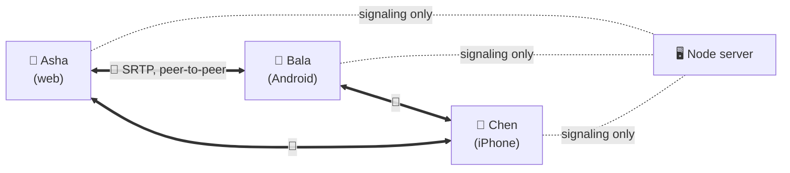

This is a **mesh**: every participant has one direct connection to every other
participant. It's simple and needs no media server, but each device uploads its
video once *per other person*, which is why rooms are capped at 6. An SFU (Step 3)
removes that limit.

| Path | Carries | Goes through the server? |
|------|---------|--------------------------|
| **Signaling** (WebSocket) | small JSON: join, offers, answers, ICE candidates, chat, mute state | ✅ yes |
| **Media** (WebRTC) | audio, video, screen share (encrypted) | ❌ no, device ↔ device |

---

## 2. Accounts and sign-in (MongoDB + JWT)

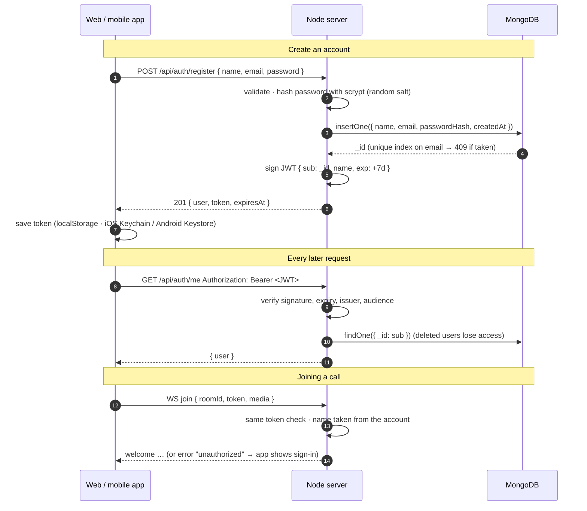

**The `users` collection**

```js
{
  _id: ObjectId,            // becomes the JWT "sub" and PeerInfo.userId
  name: "Asha Verma",
  email: "asha@example.com", // stored lower-cased; unique index "email_unique"
  passwordHash: "scrypt$16384$8$1$<salt>$<hash>",
  createdAt: Date, updatedAt: Date, lastLoginAt: Date | null
}
```

**Why these choices**

| Decision | Reason |
|---|---|
| **scrypt** (Node built-in) for passwords | memory-hard like bcrypt/argon2, no native module to compile on Windows/macOS; parameters are stored with each hash so they can be raised later |
| **JWT (HS256)** with fixed algorithm | stateless: the WebSocket can authenticate without a session store; pinning the algorithm rules out `alg: none` and algorithm-confusion attacks |
| Token checked against MongoDB on use | a deleted account stops working immediately, not when its token expires |
| Same error for wrong password and unknown email (plus a dummy hash check) | attackers can't discover which emails have accounts |
| Rate limits: 10 logins / 15 min per email, 50 per IP, 20 sign-ups / hour per IP | slows password guessing; set `TRUST_PROXY=true` behind a proxy so the real IP is used |
| Name comes from the token, not the client | nobody can join a call pretending to be someone else |
| Mobile token in **expo-secure-store** | encrypted by the OS keychain/keystore instead of plain storage |

**Known trade-offs:** there is no refresh token yet (sign in again after 7 days),
and logging out deletes the token on the device but doesn't revoke it on the
server. Both are on the roadmap. For revocation, add a `tokenVersion` field to
users and include it in the JWT.

---

## 3. The shared call engine (`shared/src/CallClient.ts`)

Both React apps use **the same** `CallClient`. The UI never touches WebRTC; it
calls a small API and re-renders on events:

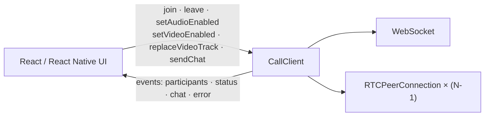

It only uses standard WebRTC globals. On mobile, `react-native-webrtc`'s
`registerGlobals()` (in `mobile/index.js`) installs `RTCPeerConnection`,
`MediaStream` and `navigator.mediaDevices`, so the same code runs unchanged.

Key behaviors:

- **Who calls whom:** the *newcomer* sends an offer to everyone already in the
  room; existing members only answer. Two people never send offers to each other
  at the same moment ("glare").
- **Fixed audio and video slots:** every connection negotiates one audio and one
  video slot up front. Screen sharing and flipping the camera then just swap the
  outgoing track with `sender.replaceTrack()`, which needs **no renegotiation**.
- **Early ICE candidates** that arrive before the offer/answer are queued, then
  applied once it lands.
- **ICE restart:** if a connection fails, the side that made the original offer
  retries with a fresh `iceRestart` offer.
- **Reconnect:** if the WebSocket drops, the client tears down its peers and
  rejoins with backoff (1s, 2s, 4s, 8s), up to 5 times.

---

## 4. What the Node.js server does

`server/src/app.js` runs one Node process that does two jobs on one port (3001):

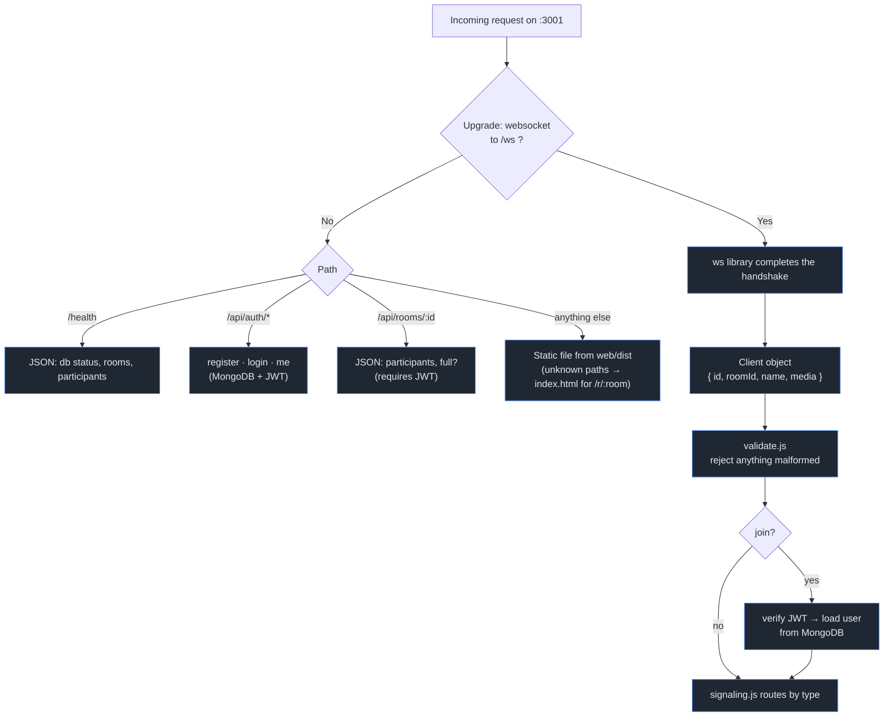

Node fits this job well because it is **single-threaded and event-driven**: one
process can hold thousands of idle WebSocket connections cheaply and wakes up
only when a message arrives.

Safety built into the server:

| Concern | How it's handled |
|---|---|
| Who are you? | `join` must carry a valid JWT; the name shown to others comes from the account |
| Malformed / hostile input | every message is parsed and checked in `validate.js` (types, lengths, room-id pattern); HTTP bodies are capped at 16 KB |
| Huge messages | `maxPayload` 64 KB; SDP ≤ 32 KB; chat ≤ 1000 chars |
| Chat spam | max 5 messages per 5 s per person, extras dropped |
| Signals to the wrong person | relayed only to the `to` peer, and only within the same room |
| Dead connections | ping every 30 s; no pong → terminated → `peer-left` sent |
| Overcrowding | `MAX_PEERS` cap → `room-full` error |
| Cross-site sockets | optional `ALLOWED_ORIGINS` allow-list (native apps send no Origin) |

### How a WebSocket works under the hood

The `ws` library handles this for us (Step 1 implemented it by hand; see git
history). A WebSocket starts as a normal HTTP request and is then *upgraded*:

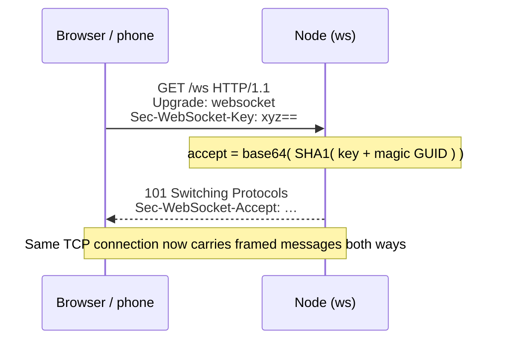

After that, data travels in small **frames** (an opcode such as text, close or
ping, a length, and a payload that is masked when it comes from the client). Our
messages are text frames containing JSON.

---

## 5. Joining a group call

What happens when Chen joins a room where Asha and Bala are already talking:

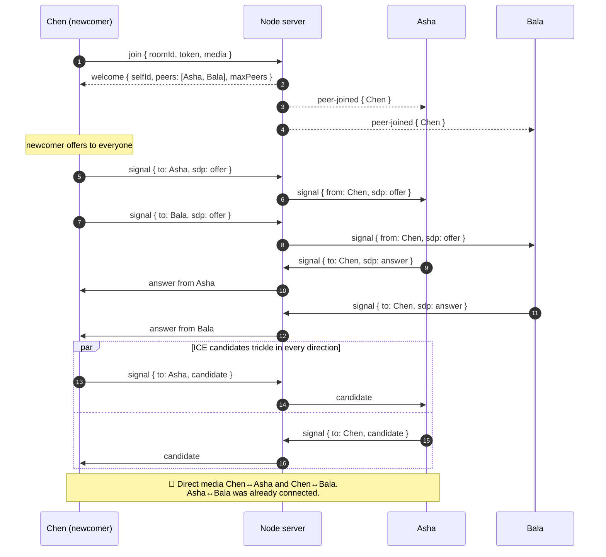

Leaving is the reverse: the socket closes (or sends `leave`), the server
broadcasts `peer-left`, and everyone closes that one peer connection.

---

## 6. Server state

Call state lives in memory (only accounts are stored in MongoDB):

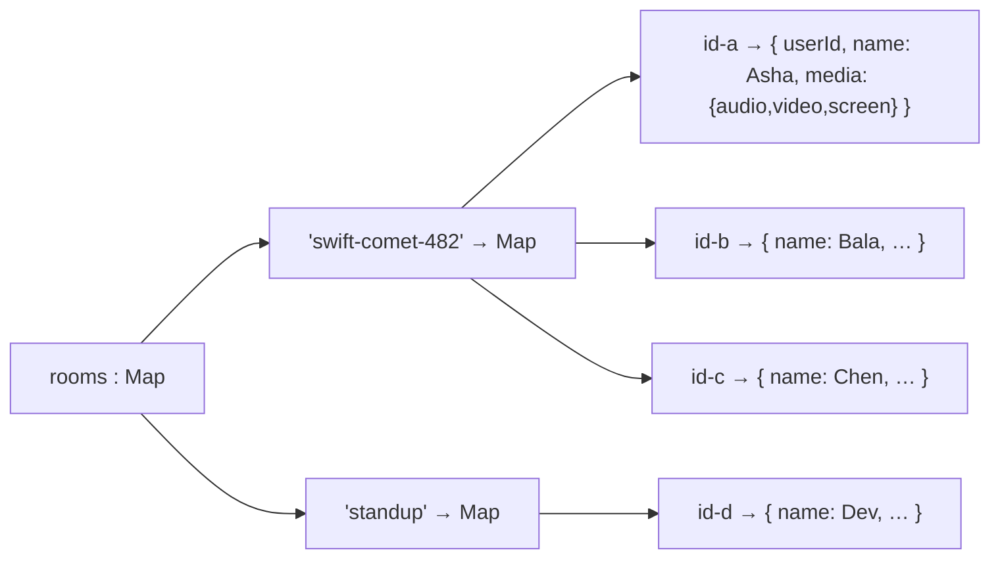

Rooms are created on first join and deleted when the last person leaves. To run
**several server instances** behind a load balancer later, this map would move to
Redis (pub/sub) so instances can relay to each other.

---

## 7. Signaling protocol

Defined once in `shared/src/protocol.ts` and validated by `server/src/validate.js`.

**Client → server**

| Message | Purpose |
|---|---|
| `{ type:"join", roomId, token, media }` | enter a room; `token` is your JWT |
| `{ type:"signal", to, data }` | send `data` (SDP offer/answer or ICE candidate) to one peer |
| `{ type:"chat", text }` | message everyone in the room |
| `{ type:"media-state", media }` | announce mic / camera / screen-share state |
| `{ type:"leave" }` | leave politely (closing the socket also works) |

**Server → client**

| Message | Purpose |
|---|---|
| `{ type:"welcome", selfId, roomId, peers[], maxPeers }` | you're in; here's who is already here |
| `{ type:"peer-joined", peer }` | someone new arrived (they'll send you an offer) |
| `{ type:"peer-left", id }` | someone left |
| `{ type:"signal", from, data }` | WebRTC data from a peer |
| `{ type:"chat", message }` | chat message (sent to the sender too, as confirmation) |
| `{ type:"media-state", id, media }` | someone muted / turned the camera off / started sharing |
| `{ type:"error", code, message }` | `unauthorized`, `room-full`, `bad-request`, `not-joined`, `already-joined` |

`media` is `{ audio: boolean, video: boolean, screen: boolean }`. A peer is
`{ id, userId, name, media }`: `id` identifies the connection (one per tab or
device) and `userId` identifies the account.

---

## 8. UI design

The app is built around one signature element, a **camera aperture** (`web/src/components/Aperture.tsx`,
`mobile/src/components/Aperture.tsx`). It's six blades over whatever the lens is showing:

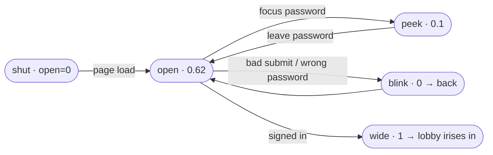

How it's drawn: each blade is a half-plane rotated 60° from the last and pushed
`open × 118` units out from the centre, so the gap between them is a hexagon.
Closing also twists the blades up to 34°, like a real iris. On the web it's one
SVG with CSS transitions; on mobile it's plain `Animated.View`s on the native
driver. Around the sign-in lens, an engraved aperture scale (f/1.4 to f/16)
turns to show the current opening.

**Colour** comes from four "film stock" palettes (`:root[data-theme='…']` in
`web/src/styles.css`): Kodachrome (default), Cyanotype (light), Velvia and
Darkroom. Every palette sets the same roles, `--bg`, `--surface`, `--text`,
`--muted`, `--accent` (+ `--accent-ink`), `--hot` (live/leave), `--cool`
(connected/speaking), `--well` (video background) and the lens blade colours,
plus RGB triplets for translucent tints. Components never use raw colours.

`web/src/theme.ts` applies the saved film before first paint (no flash) and runs
the change like a camera: `huddle:shutter-close` → swap `data-theme` inside a
View Transition → `huddle:shutter-open`. Every lens on screen listens and blinks.

Type is TeX Gyre Adventor, self-hosted. Everything respects `prefers-reduced-motion`.


The four directions below were explored before the aperture concept:

### 01 · Midnight: focused 1-to-1
Dark, calm, two equal tiles. The active speaker gets an outline.
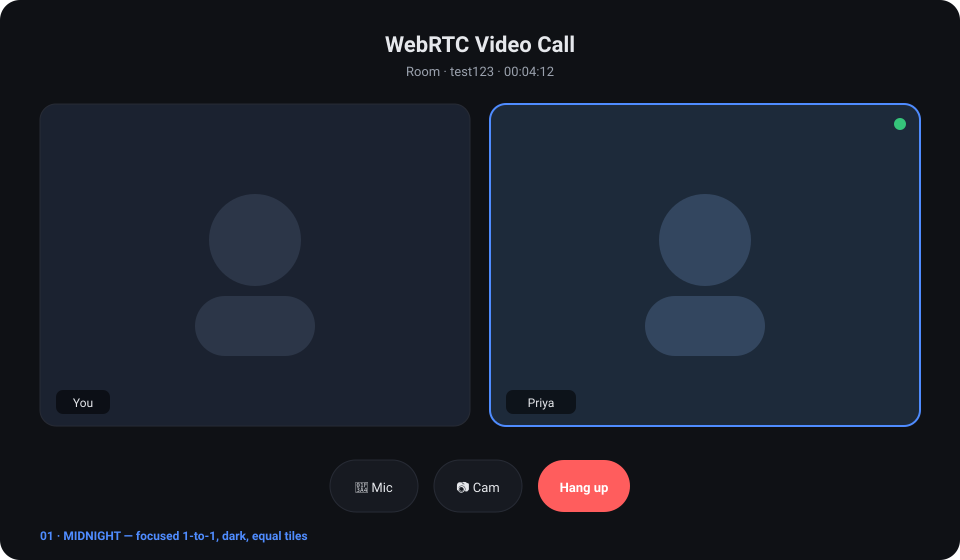

### 02 · Aurora: immersive
The remote person fills the screen over a gradient, your camera floats as a
picture-in-picture, and controls sit in a frosted-glass dock.
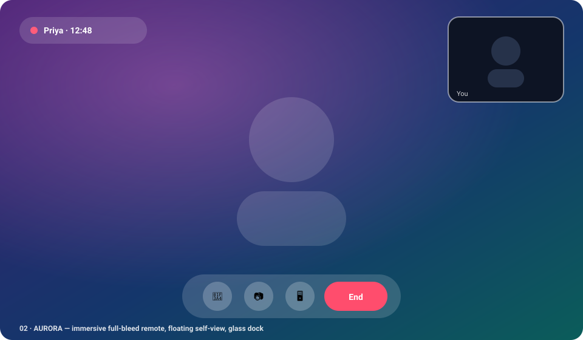

### 03 · Paper: group calls
A warm light theme with a 6-person grid, speaking indicator, mute badges and a
side chat panel.
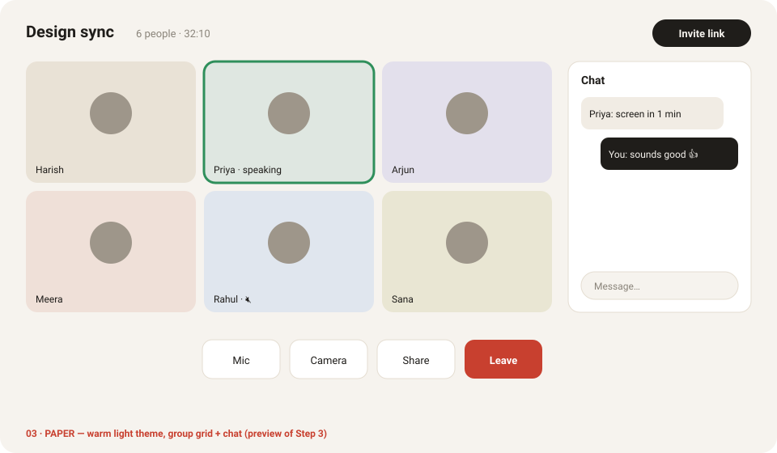

### 04 · Mobile
A portrait in-call screen with a self-view, plus a home screen with
"join with room code".
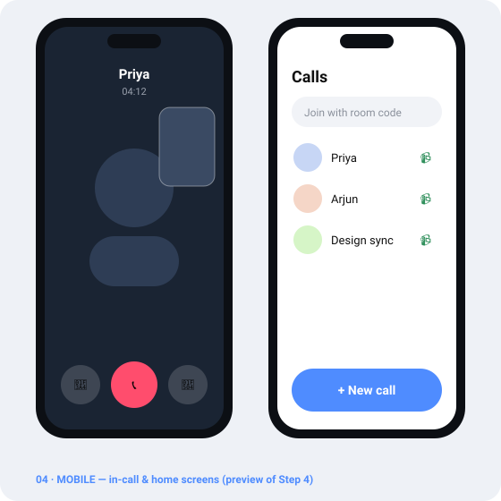

---

## 9. Known limits and what's next

| Limit | Why | Fix |
|---|---|---|
| Calls can fail on strict corporate / mobile-carrier networks | only STUN is configured; direct paths are sometimes blocked | **Step 2:** TURN server (coturn) |
| Camera/mic need HTTPS off `localhost` | browser security rule | **Step 2:** HTTPS + WSS (e.g. Caddy / nginx + Let's Encrypt) |
| Max 6 per room | mesh upload cost grows with each person | **Step 3:** SFU (mediasoup) |
| One server instance | room state and rate limits are in memory | Redis pub/sub when scaling out |
| No refresh tokens / server-side logout | JWTs are stateless | refresh tokens + `tokenVersion` on the user |
| Mobile audio uses the OS default route | no audio-route manager yet | add `react-native-incall-manager` for speaker/earpiece/Bluetooth |
