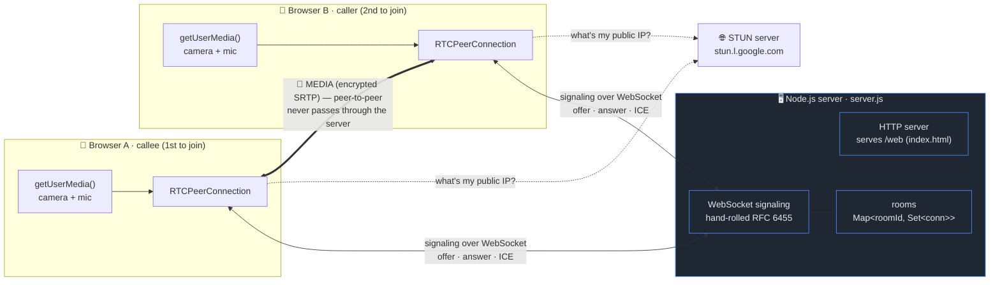
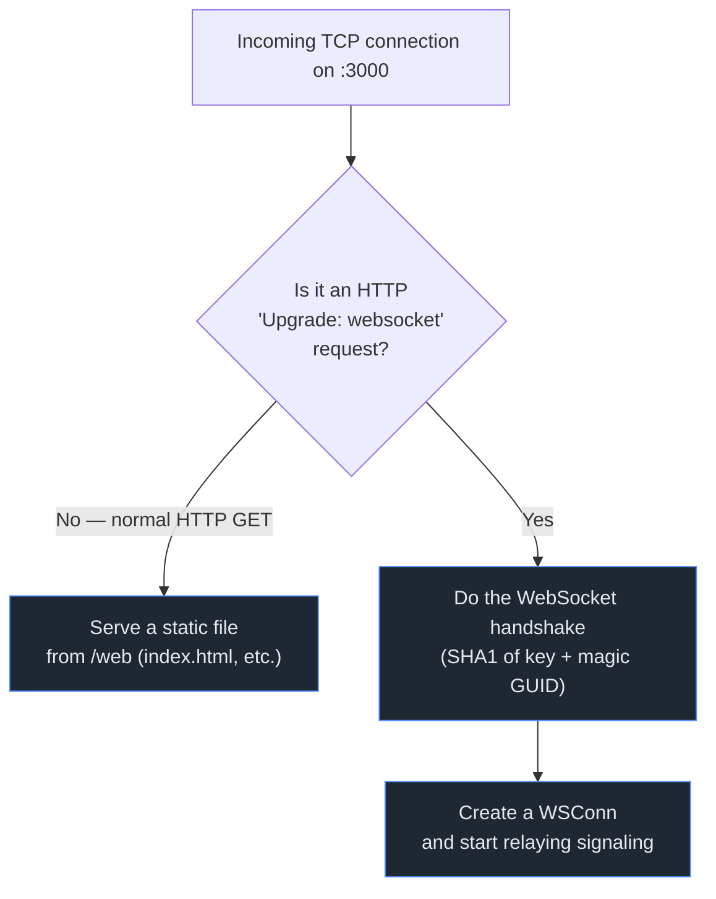
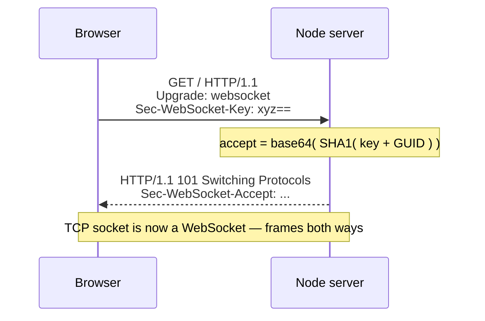
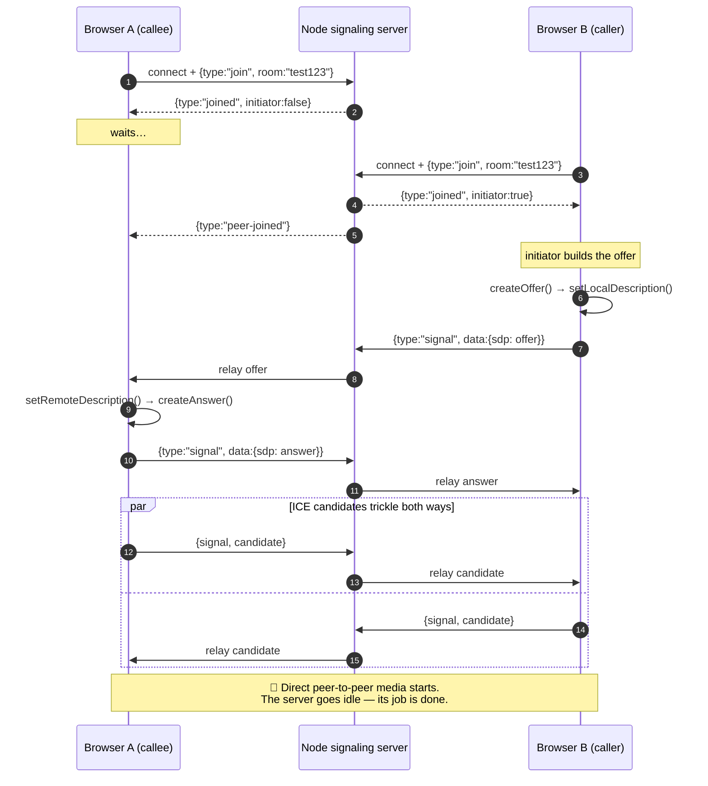
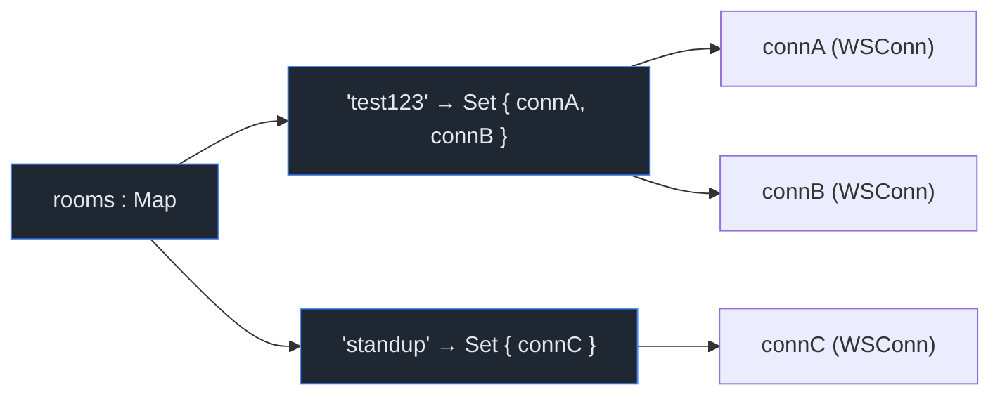

# Architecture — how WebSocket & Node.js work together

This document explains the moving parts of **Step 1** (1-to-1 WebRTC call): what
the Node.js server does, how the hand-rolled WebSocket signaling layer works, and
how two browsers end up streaming video directly to each other.

> **The one idea to hold onto:** the Node server is only a *matchmaker*. It helps
> two browsers find each other and exchange connection details. Once they're
> connected, **audio and video flow directly between the browsers** — the server
> never sees a single video frame.

---

## 1. System architecture



**Two completely separate data paths:**

| Path | Carries | Goes through the server? |
|------|---------|--------------------------|
| **Signaling** (thin WebSocket) | small JSON: offers, answers, ICE candidates | ✅ yes — this is the server's whole job |
| **Media** (WebRTC) | the actual audio & video | ❌ no — flows browser ↔ browser directly |

---

## 2. What the Node.js server is doing

`server.js` is a single Node process wearing **two hats** on the same port (3000):



1. **HTTP hat** → a browser asks for `http://localhost:3000/`, the server reads
   `web/index.html` off disk and sends it back. Plain static file serving.
2. **WebSocket hat** → the same page then opens a `new WebSocket(...)` back to the
   server. Node emits an `'upgrade'` event; the server completes the WebSocket
   handshake and keeps that TCP socket open as a two-way message channel.

Node is a great fit here because it's **single-threaded + event-driven**: one
process can hold hundreds of idle WebSocket connections open cheaply, waking up
only when a message actually arrives. No thread-per-connection, no blocking.

---

## 3. The hand-rolled WebSocket layer (no `ws` library)

Step 1 has **zero dependencies** — the WebSocket protocol is implemented directly
in `server.js`. Two things make a raw TCP socket into a WebSocket:

### a) The handshake (once, at connection time)



### b) Frame encoding/decoding (every message after that)

WebSocket data travels in **frames**, not plain bytes. The `WSConn` class parses
them. A frame looks like this:

```
 0                   1                   2                   3
 0 1 2 3 4 5 6 7 8 9 0 1 2 3 4 5 6 7 8 9 0 1 2 3 4 5 6 7 8 9 0 1
+-+-+-+-+-------+-+-------------+-------------------------------+
|F|R|R|R|opcode |M| Payload len |   Extended length (if 126/127)|
|I|S|S|S| (4)   |A|    (7)      |                               |
|N|V|V|V|       |S|             |                               |
| |1|2|3|       |K|             |                               |
+-+-+-+-+-------+-+-------------+ - - - - - - - - - - - - - - - +
|   Masking key (client→server only, 4 bytes)   | Payload data  |
+-----------------------------------------------+---------------+
```

What the parser in `WSConn._parse()` handles:
- **Opcodes:** `0x1` text (our JSON), `0x8` close, `0x9` ping → auto-reply pong.
- **Masking:** browser→server frames are XOR-masked with a 4-byte key; the server
  un-masks them. Server→browser frames are sent **unmasked** (per spec).
- **Length:** 7-bit for small messages, 16-bit (`126`) for larger SDP blobs,
  64-bit (`127`) just in case.
- **Partial TCP reads:** TCP can split one frame across chunks, so bytes are
  buffered until a whole frame has arrived.

The browser side needs none of this — `new WebSocket()` is built into every
browser. We only had to implement the **server** half.

---

## 4. The signaling dance (join → offer → answer → ICE → media)

This is the full sequence when two people join the same room:



**Why the 2nd joiner is the "caller":** someone has to make the first offer. The
rule is simple — if a room already has one person when you join, *you* are the
initiator and create the offer. The server decides this with one line:
`isInitiator = room.size === 1`.

---

## 5. Room & connection state

All server state is a single in-memory map. No database in Step 1.



- **Join:** add the connection to the room's `Set`. Reject with `room-full` if the
  set already has 2 (Step 1 is a 2-person mesh).
- **Relay:** a `signal` message is forwarded to *every other* connection in the
  same room (just one peer, in a 1-to-1 call).
- **Leave:** on socket close, drop the connection, tell the remaining peer
  `peer-left`, and delete the room once it's empty.

This map is exactly the part that grows in later steps — an **SFU** replaces the
"relay to the other peer" logic to support group calls.

---

## 6. Signaling message protocol

Every message is a small JSON object over the WebSocket:

| Direction | Message | Meaning |
|-----------|---------|---------|
| client → server | `{ type:"join", room }` | join / create a room |
| server → client | `{ type:"joined", initiator }` | you're in; are you the caller? |
| server → client | `{ type:"peer-joined" }` | someone else joined your room |
| server → client | `{ type:"room-full" }` | room already has 2 people |
| server → client | `{ type:"peer-left" }` | the other person disconnected |
| client ↔ server | `{ type:"signal", data }` | relay `data` to the other peer |

`data` inside a `signal` is one of:
- `{ sdp: {...} }` — an SDP **offer** or **answer** (the media "menu")
- `{ candidate: {...} }` — an **ICE candidate** (a possible network route)

---

## 7. UI design mockups

Four design directions for the app. **01 Midnight** is what Step 1 ships today;
the others show where the UI can go as the app grows.

### 01 · Midnight — focused 1-to-1 (current build)
Dark, calm, two equal tiles. The active speaker gets a blue outline.


### 02 · Aurora — immersive
The remote person fills the screen over a gradient, your camera floats as a
picture-in-picture, and controls sit in a frosted-glass dock.


### 03 · Paper — group calls (Step 3 preview)
Warm light theme with a 6-person grid, speaking indicator, mute badges, and a
side chat panel — the layout the SFU step will need.


### 04 · Mobile (Step 4 preview)
Portrait in-call screen with a draggable self-view, plus a home screen with
recent calls and "join with room code".


### Wireframe of the current call screen

```
┌───────────────────────────────────────────────────────────┐
│                    WebRTC Video Call                        │
│                 Step 1 · 1-to-1 · peer-to-peer              │
│                                                             │
│      ┌──────────────────────────┐  [  Join  ]              │
│      │  Room name: test123      │                          │
│      └──────────────────────────┘                          │
│                                                             │
│              status: In call ✓                              │
│                                                             │
│   ┌──────────────────────┐   ┌──────────────────────┐      │
│   │                      │   │                      │      │
│   │                      │   │                      │      │
│   │     [ your cam ]     │   │   [ remote cam ]     │      │
│   │                      │   │                      │      │
│   │  You                 │   │  Remote              │      │
│   └──────────────────────┘   └──────────────────────┘      │
│                                                             │
│        [ Mute mic ]   [ Stop camera ]   [ Hang up ]         │
└───────────────────────────────────────────────────────────┘
```

| Element | Backed by |
|---------|-----------|
| "You" tile | local `MediaStream` from `getUserMedia()` |
| "Remote" tile | remote stream delivered by `pc.ontrack` |
| Join | opens WebSocket + sends `join` |
| Mute / Stop camera | toggles `track.enabled` on local tracks |
| Hang up | closes the peer connection, socket, and local tracks |

---

## 8. What this intentionally does NOT do yet

| Missing piece | Why it matters | Arrives in |
|---------------|----------------|------------|
| **TURN server** | direct P2P fails across many real networks/firewalls | Step 2 |
| **HTTPS/WSS** | camera/mic need a secure context off `localhost` | Step 2 |
| **SFU** | mesh P2P collapses past ~4 people | Step 3 |
| **Mobile clients** | web-only for now | Step 4 |
| **Auth, reconnection, screen share** | polish | Step 5 |

See the roadmap in [README.md](./README.md).
