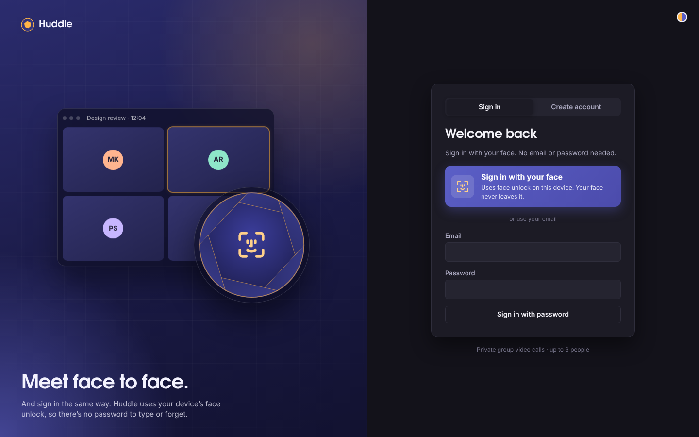
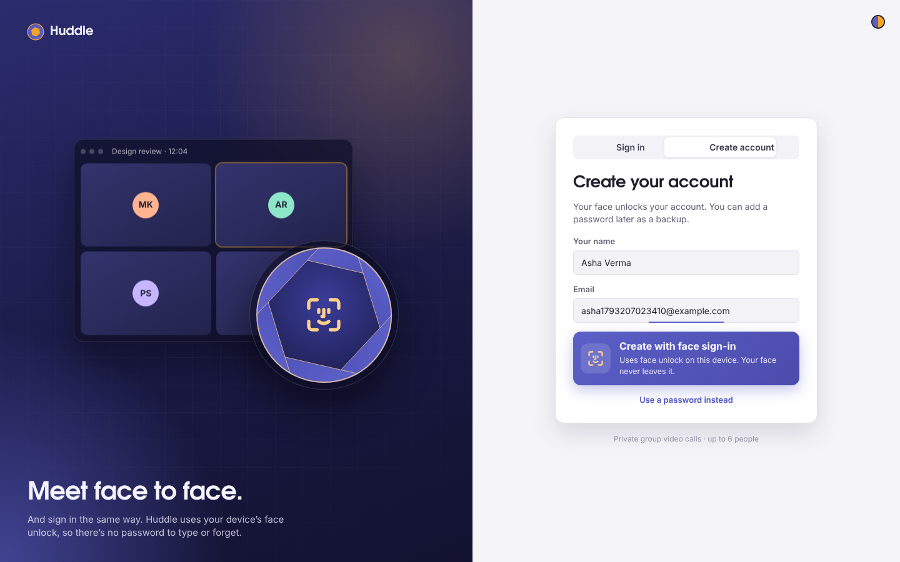
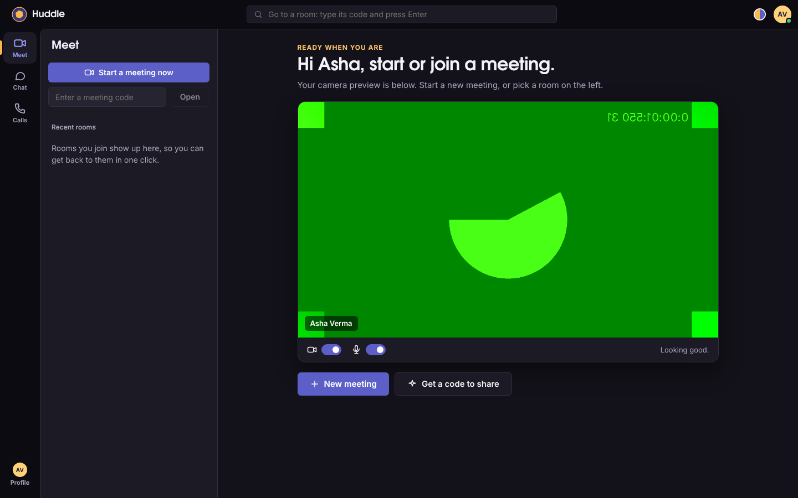
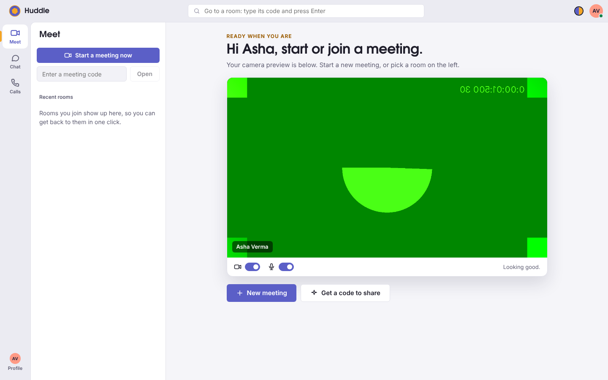
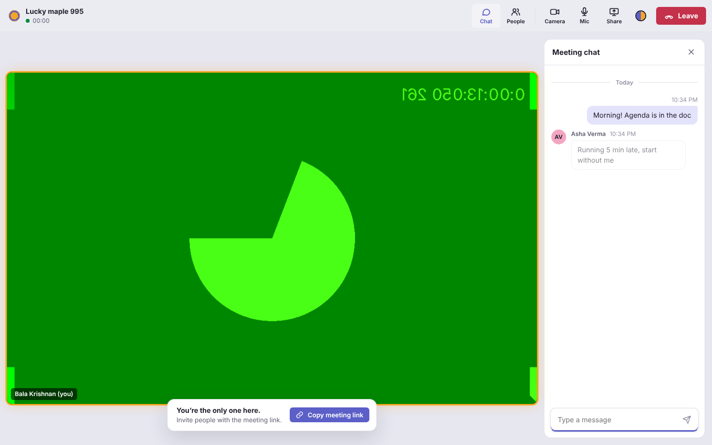
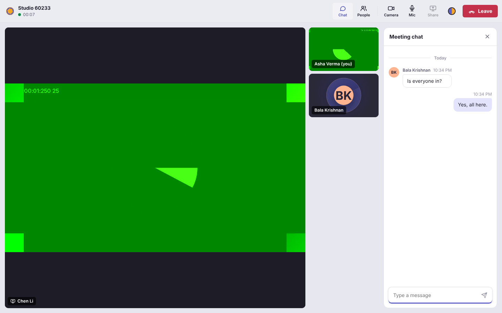
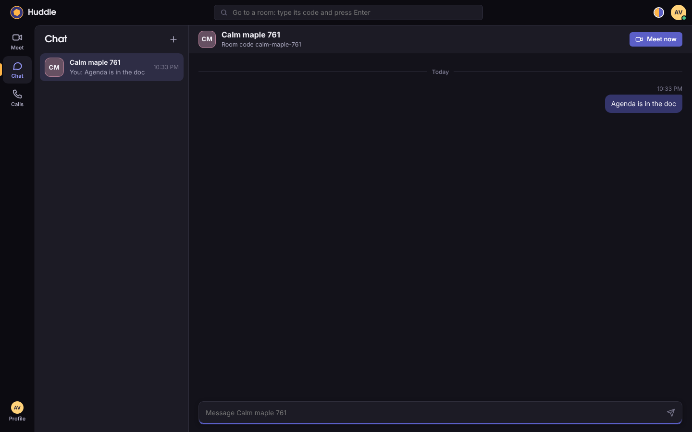
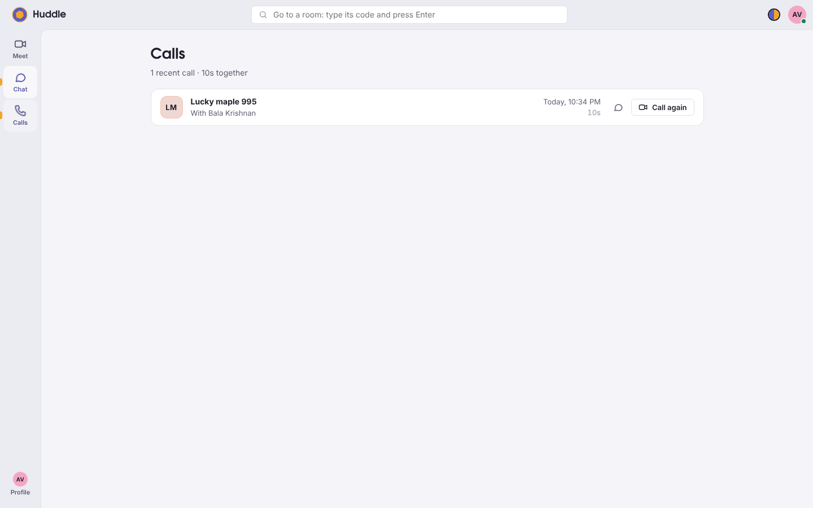
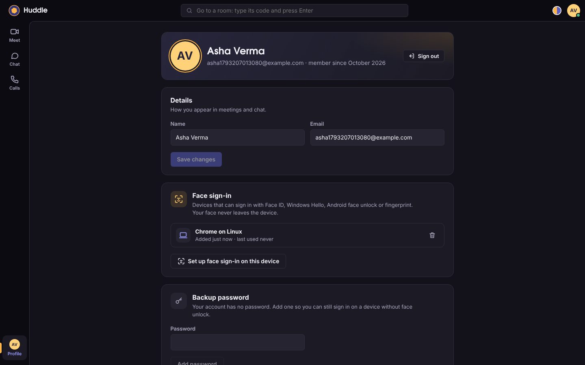
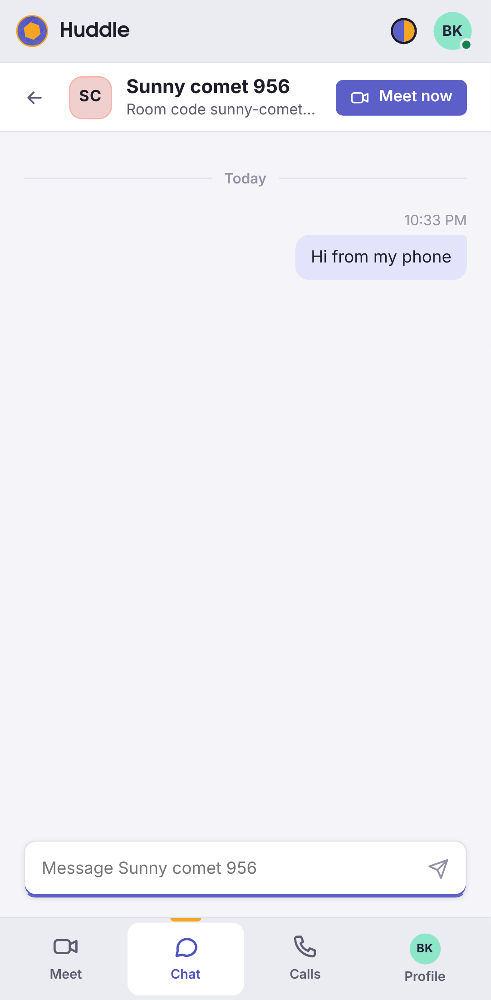

# Huddle: meetings, chat and face sign-in (React · React Native · Node.js · MongoDB)

Private group video meetings for up to 6 people, on **web, Android and iOS**,
built from scratch on **WebRTC**. The app is laid out like **Microsoft Teams**
(a left app rail with Meet, Chat, Calls and Profile), with a camera-lens twist.
You **sign in and register with your face**: Face ID, Windows Hello, Android
face unlock or a fingerprint. Email and password stay available as a backup.
No paid video vendor is involved: the Node.js server only introduces people to
each other, and audio and video flow directly between devices.

| Sign in with your face | Create an account with your face |
|---|---|
|  |  |

| Meet (dark) | Meet (light) |
|---|---|
|  |  |

| In a meeting, with chat | Screen share |
|---|---|
|  |  |

| Chat tab | Calls tab | Profile & face sign-in devices | Phone |
|---|---|---|---|
|  |  |  |  |

*(Screenshots come from automated tests that use Chrome's fake camera, so the videos show green test patterns.)*

## Put it online

**[DEPLOY.md](./DEPLOY.md)**: rent a small server, get a free DuckDNS address, run one
script. You get HTTPS, MongoDB, a TURN relay for calls on any network, and nightly
backups. The website can be added to a phone's home screen like an app.

## How face sign-in works

Your face is **never sent anywhere**. The phone or computer checks it with its
own face unlock, the same way it unlocks itself, and only then signs a
one-time challenge from the server.

- **Web: passkeys (WebAuthn).** When you register, the browser asks the
  device's face unlock to create a key pair. The private key stays in the
  device's secure chip; the server stores only the public key. Signing in, the
  server sends a random challenge, the device checks your face and signs it,
  and the server verifies the signature. No email needed: the device offers
  your Huddle passkey. Synced passkeys (iCloud Keychain, Google Password
  Manager) also work on your other devices, and a phone can sign you in on a
  computer by scanning a QR code.
- **Mobile app: a key behind Face ID.** The server gives the phone a random
  key, kept in the iOS Keychain / Android Keystore with
  `requireAuthentication`, so the OS releases it only after Face ID, face
  unlock or fingerprint succeeds.
- **Password as a backup.** A face-only account can add a password in Profile.
  An account made with a password is offered "Sign in with your face next
  time" once. You can't remove your last way in.
- The server checks every passkey response itself (`server/src/auth/webauthn.js`,
  no third-party library): the challenge is single-use and expires in 5
  minutes, the page origin and site must match, user verification (face,
  fingerprint or PIN) is required, the signature is checked, and a counter
  that goes backwards (a cloned key) is rejected.

**Honest limits:** the device decides what counts as "verified". Most phones
and laptops use face or fingerprint, but some fall back to the device PIN. And
passkeys need **HTTPS** (or `localhost` while developing), so set
`WEBAUTHN_RP_ID` to your domain when you deploy.

## Design: Teams, with a lens

- **Layout like Teams:** title bar with a room search, a left **app rail**
  (Meet, Chat, Calls, Profile), a list pane, and the main stage. On phones the
  rail becomes a bottom tab bar.
- **Meetings like Teams:** a top bar with Chat, People, Camera, Mic, Share and a
  red **Leave** button; chat and people open as side panels.
- **The creative part:** a calm **indigo** for actions and a warm **amber
  "spark"** for anything live or selected (the active rail marker, the
  speaking ring around a video tile, the "You joined" line). The six-blade
  **camera aperture** is the logo; it closes over your preview when your
  camera is off, and on the sign-in page a scan line sweeps the lens while
  your device checks your face.
- **Dark and light mode:** follows your device until you pick one with the
  half-amber, half-indigo toggle. Headings use TeX Gyre Adventor; body text
  uses Segoe UI (like Teams) or the system font.

## Features

**Accounts**
- Register and sign in **with your face** (web passkeys; Face ID / face unlock in the mobile app), or with email and password
- Face sign-in devices listed in Profile, each removable; add a backup password to a face-only account
- Accounts in **MongoDB** with **scrypt**-hashed passwords; **JWT** sessions (7 days by default)
- Rate limiting, identical errors for "wrong password" and "no such account", invite links that survive sign-in
- **Profile**: change your name, email and password (changing the password signs out your other devices)

**Meet**
- Pre-join stage with camera preview and camera/mic switches, shows who is already in the meeting
- "Start a meeting now", join with a code, **Happening now** (your rooms with people in them), recent rooms
- Group meetings up to 6 people, speaking indicator, mute / camera-off shown to everyone
- Screen sharing (desktop web) with a spotlight layout, People panel with the invite link
- Recovers on its own: automatic reconnect, ICE restart, audio-only fallback

**Chat**
- Every room has a chat saved for 30 days. Read it and reply **from the Chat tab without joining the meeting**; people in the meeting see your message live
- In the meeting: "You joined" marker, load earlier messages, day dividers, unread badge

**Calls**
- Your call history: room, who was there, when, how long, and **Call again**

## Project layout

```
video-call-app/
├── shared/   @vca/shared  — protocol, CallClient (WebRTC engine) and API client, used by web AND mobile
├── server/   @vca/server  — Node.js: auth (JWT), MongoDB users, rooms, WebSocket signaling, chat
├── web/      @vca/web     — React 19 + Vite + TypeScript
├── mobile/   @vca/mobile  — React Native (Expo dev build) + react-native-webrtc
├── docker-compose.yml     — local MongoDB for development
├── Dockerfile             — production image (web build + Node server)
├── deploy/                — production stack: Caddy (HTTPS), MongoDB, coturn, backups, setup.sh
└── docs/                  — screenshots
```

See **[ARCHITECTURE.md](./ARCHITECTURE.md)** for diagrams of the system, the sign-in flow and the call flow.

## Quick start (web)

Requires **Node.js 20+**. For MongoDB, use Docker or a free MongoDB Atlas cluster.

```bash
npm install
npm run db            # starts MongoDB in Docker on localhost:27017
```

Create `server/.env` (copy `server/.env.example`) and set:

```bash
MONGODB_URI=mongodb://localhost:27017
JWT_SECRET=<paste output of: node -e "console.log(require('crypto').randomBytes(48).toString('base64url'))">
```

Then:

```bash
npm run dev
```

- Web app: **http://localhost:5173**. Create an account with your face (or a password), then start a meeting.
- Server: **http://localhost:3001** (`/health` shows whether MongoDB is connected).

Open a second browser (or a private window), create another account, and join
the same room code.

> **No MongoDB yet?** Leave `MONGODB_URI` empty and the dev server runs with a
> temporary in-memory store. It prints a warning, and accounts disappear when
> the server restarts. Production refuses to start without MongoDB and a real
> `JWT_SECRET`.

> **Camera from another device:** browsers only allow camera/mic on `https://`
> or `localhost`. Use the mobile app, or put the site behind HTTPS (Step 2).

### Production

```bash
npm run build                         # builds web/dist
NODE_ENV=production MONGODB_URI=... JWT_SECRET=... npm start
```

The Node server serves the web app, the API and the WebSocket on one port.

## Mobile app (Android & iOS)

WebRTC needs native code, so this runs as an **Expo development build**. It
won't work in the Expo Go app.

```bash
npm install
cd mobile
npx expo install --fix         # align native package versions with your Expo SDK
cp .env.example .env           # set EXPO_PUBLIC_SIGNALING_URL to your computer's LAN IP
npx expo run:android           # or: npx expo run:ios   (needs Android Studio / Xcode)
```

Face sign-in in the app uses the phone's own Face ID / face unlock / fingerprint
(`expo-local-authentication` + `expo-secure-store`); turn it on when you create
an account, or later in Profile.

Keep `npm run dev:server` running on your computer. Phone and computer must be
on the same Wi-Fi, and the server prints the address to use. Use a **real
device**: emulators/simulators have no real camera. No Android Studio or Xcode?
Build in the cloud: `npx eas build --profile development --platform android`.

## API

| Method | Path | Auth | Body → Response |
|---|---|---|---|
| POST | `/api/auth/register` | — | `{ name, email, password }` → `201 { user, token, expiresAt }` |
| POST | `/api/auth/login` | — | `{ email, password }` → `200 { user, token, expiresAt }` |
| GET | `/api/auth/me` | Bearer | → `{ user }` |
| PATCH | `/api/auth/me` | Bearer | `{ name?, email?, currentPassword? }` → `{ user, token, expiresAt }` (email change needs `currentPassword`) |
| POST | `/api/auth/password` | Bearer | `{ currentPassword, newPassword }` → `{ user, token, expiresAt }`; older tokens stop working. Face-only accounts send just `newPassword` to add a backup password |
| POST | `/api/auth/passkey/register/options` | — or Bearer | `{ name, email }` (new account) → WebAuthn creation options; with Bearer: add this device |
| POST | `/api/auth/passkey/register/verify` | — or Bearer | `{ credential }` → `201 { user, token, expiresAt }` (new) / `{ credentials }` (added) |
| POST | `/api/auth/passkey/login/options` | — | → WebAuthn request options (single-use challenge) |
| POST | `/api/auth/passkey/login/verify` | — | `{ credential }` → `{ user, token, expiresAt }` |
| POST | `/api/auth/device/register` | — or Bearer | `{ name, email, deviceName }` → `{ user, token, device: { id, secret } }` (mobile app) |
| POST | `/api/auth/device/login` | — | `{ deviceId, secret }` → `{ user, token, expiresAt }` |
| GET | `/api/auth/credentials` | Bearer | → `{ credentials }` (your face sign-in devices) |
| DELETE | `/api/auth/credentials/:id` | Bearer | → `{ credentials }`; `409` if it's your only way in |
| GET | `/api/rooms/:id` | Bearer | → `{ roomId, participants, people, maxPeers, full }` |
| POST | `/api/rooms/:id/messages` | Bearer | `{ text }` → `201 { message }`; also sent live to people in the meeting |
| GET | `/api/chats` | Bearer | → `{ chats }`: your rooms, last message, who's in the meeting now |
| GET | `/api/calls` | Bearer | → `{ calls }`: room, with whom, start, end, duration |
| GET | `/api/rooms/:id/messages?before=<ts>&limit=50` | Bearer | → `{ messages, hasMore }` (oldest first; for "Load earlier") |
| GET | `/health` | — | → `{ ok, db, store, rooms, participants }` |
| WS | `/ws` | token in `join` | signaling, see ARCHITECTURE.md |

Errors are `{ error, code?, fields? }`. `fields` holds per-field messages for
forms (e.g. `{ email: "Already registered…" }`).

## Scripts

| Command | What it does |
|---|---|
| `npm run dev` | server + web with hot reload |
| `npm run db` | start MongoDB in Docker |
| `npm run dev:server` / `dev:web` / `dev:mobile` | one at a time |
| `npm test` | server tests (auth, face sign-in, JWT, passwords, MongoDB stores, signaling, chat, calls) |
| `npm run build` | production web build |
| `npm start` | production server (serves `web/dist`) |

## Configuration

| Where | Variable | Default |
|---|---|---|
| server | `MONGODB_URI`, `MONGODB_DB` | in-memory in dev (required in prod), `huddle` |
| server | `JWT_SECRET`, `JWT_EXPIRES_IN` | dev-only secret (required in prod), `7d` |
| server | `WEBAUTHN_RP_ID`, `WEBAUTHN_ORIGINS` | the page's own host in dev; **required in prod** (your domain, e.g. `huddle.example.com`, and `https://huddle.example.com`) |
| server | `TURN_URLS`, `TURN_SECRET`, `TURN_TTL_SEC`, `STUN_URLS` | no TURN, `12h` credentials, Google STUN (set by `deploy/` automatically) |
| server | `CHAT_RETENTION_DAYS` | `30` (MongoDB deletes older messages on its own) |
| server | `PORT`, `HOST`, `MAX_PEERS`, `ALLOWED_ORIGINS`, `TRUST_PROXY`, `WEB_DIST` | `3001`, `0.0.0.0`, `6`, `*`, `false`, `../web/dist` |
| web | `VITE_API_URL`, `VITE_SIGNALING_URL`, `VITE_ICE_SERVERS` | same origin, same host `/ws`, Google STUN |
| mobile | `EXPO_PUBLIC_SIGNALING_URL`, `EXPO_PUBLIC_ICE_SERVERS` | — (set your LAN IP), Google STUN |

Each folder has a `.env.example`.

## What's tested

- **Server (49 tests):**
  - **Face sign-in:** a software authenticator makes real P-256 passkeys and signatures. Checked: register a face-only account, sign in without an email, a response can't be replayed, and rejection of a missing face/PIN check, a wrong site or origin, a forged signature and a cloned key (counter going backwards). Fuzzing with 20,000 corrupted responses gives clean errors, never a crash. Also: adding a passkey to a password account (and nobody else can finish it), the last way in can't be removed, a backup password can be added, and mobile device keys (wrong or removed keys stop working; secrets are never stored or listed).
  - JWT tampering, expiry, wrong key or audience, and `alg: none`; salted password hashes; sign-up/sign-in validation, duplicate emails, rate limits.
  - Meetings: a token is required, names can't be spoofed, room cap, relay, chat, mute state.
  - Profile changes; saved chat (history, paging, retention); Chat and Calls tabs (last message, who's in the meeting, sending from outside a meeting reaches people inside, call history with names).
  - TURN credentials (coturn REST scheme, expiry, sent on join) and production config checks.
  - MongoDB stores (users, chat, face sign-in devices, calls) against fake collections. Set `MONGODB_URI` to run against a real database.
- **Web, end to end in Chromium (30 checks)** with Chrome's virtual authenticator standing in for face unlock: register with face, sign out and back in with face, a failed face check, a device with no passkey, adding a backup password and signing in with it, a password account turning on face sign-in from the banner, then a two-person meeting (pre-join shows who's there, unread badge, People panel), the Chat tab (live marker, message from the tab reaches the meeting), the Calls tab, the dark/light toggle, and the phone layout (bottom tabs, no sideways scrolling).
- **3-person meeting (3 checks):** everyone sees everyone, chat, screen-share spotlight.
- **CI on GitHub** (`.github/workflows/ci.yml`): server tests, web typecheck and build, and the production Docker image built and started on every push.
- **Mobile:** written against `react-native-webrtc`, `expo-secure-store` and `expo-local-authentication`, and syntax-checked. It still needs a first run on a real phone (Face ID needs a device, not a simulator).

## Roadmap

- [x] Step 1: 1-to-1 web call
- [x] Full app: React web + React Native mobile + Node server, group calls, chat, screen share
- [x] **Accounts**: MongoDB + JWT, sign-in / sign-up on web and mobile
- [x] **Step 2**: deployment with HTTPS, TURN (coturn) with short-lived credentials, MongoDB backups ([DEPLOY.md](./DEPLOY.md))
- [x] Profile editing and saved call chat (web + mobile)
- [x] **Face sign-in** (passkeys + Face ID / face unlock) and a Teams-style layout with Chat and Calls tabs
- [ ] Forgot-password email, refresh tokens, direct messages
- [ ] **Step 3**: SFU (mediasoup) for bigger rooms (10–20+)
