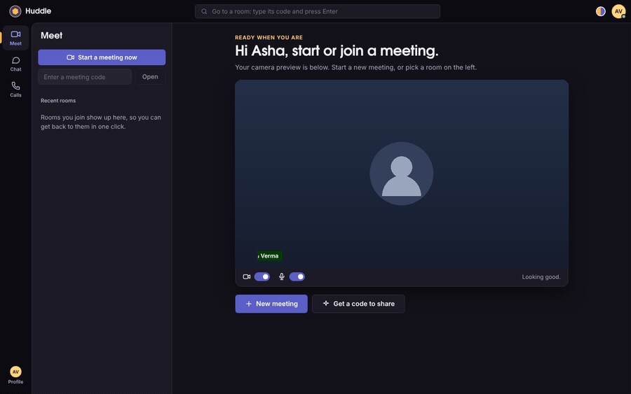
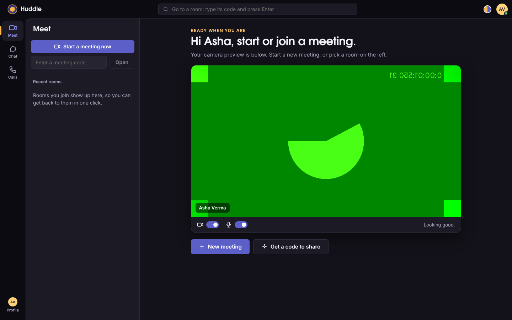
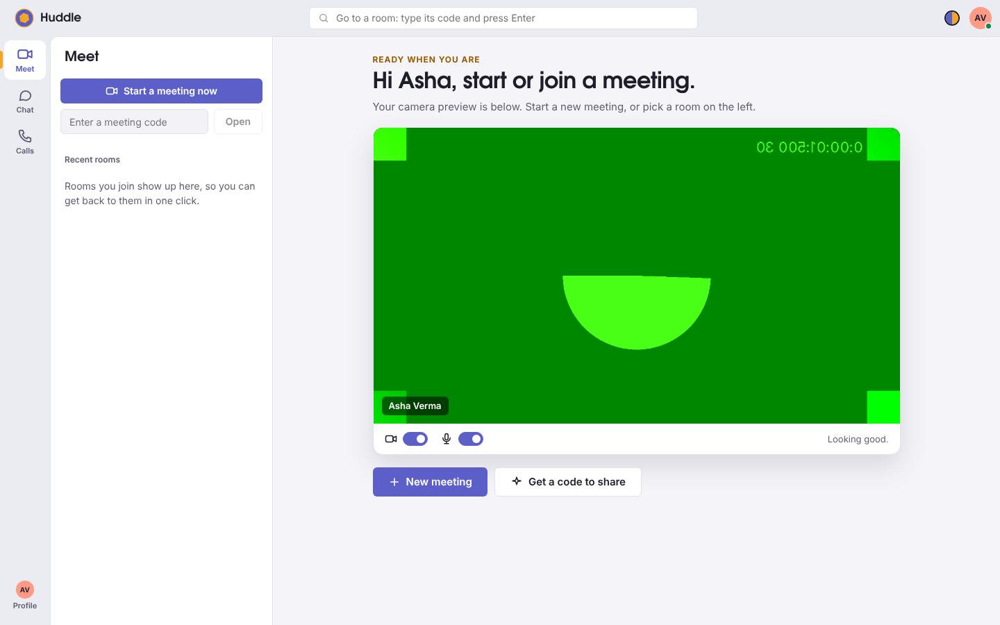
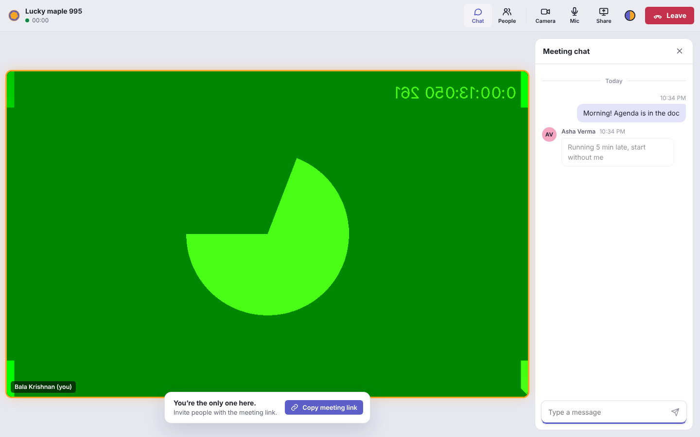
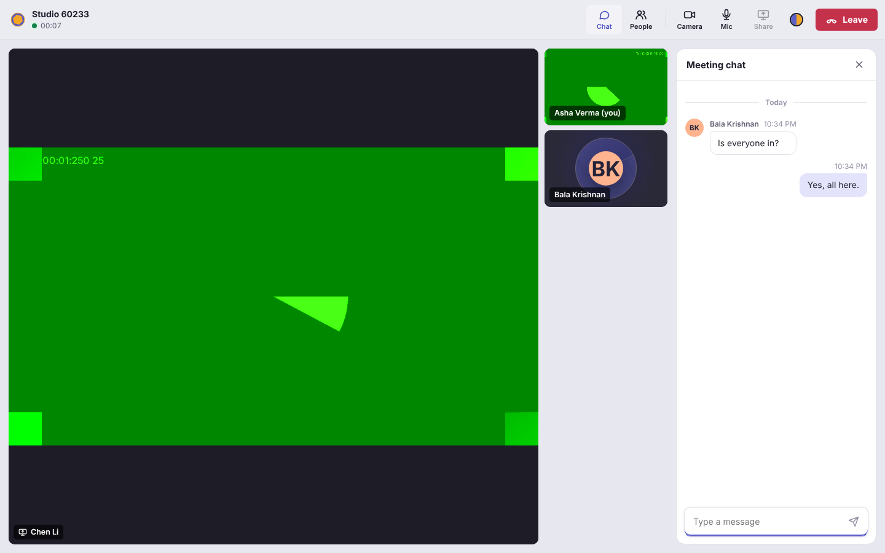
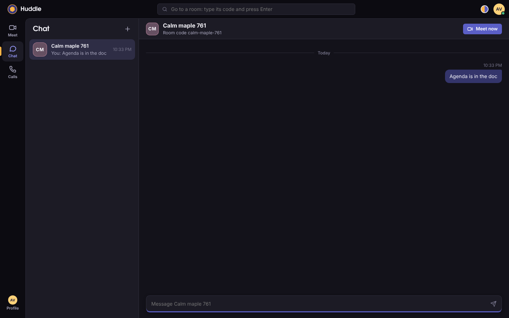
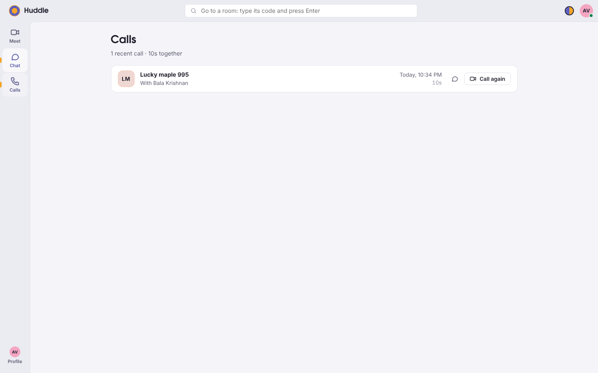
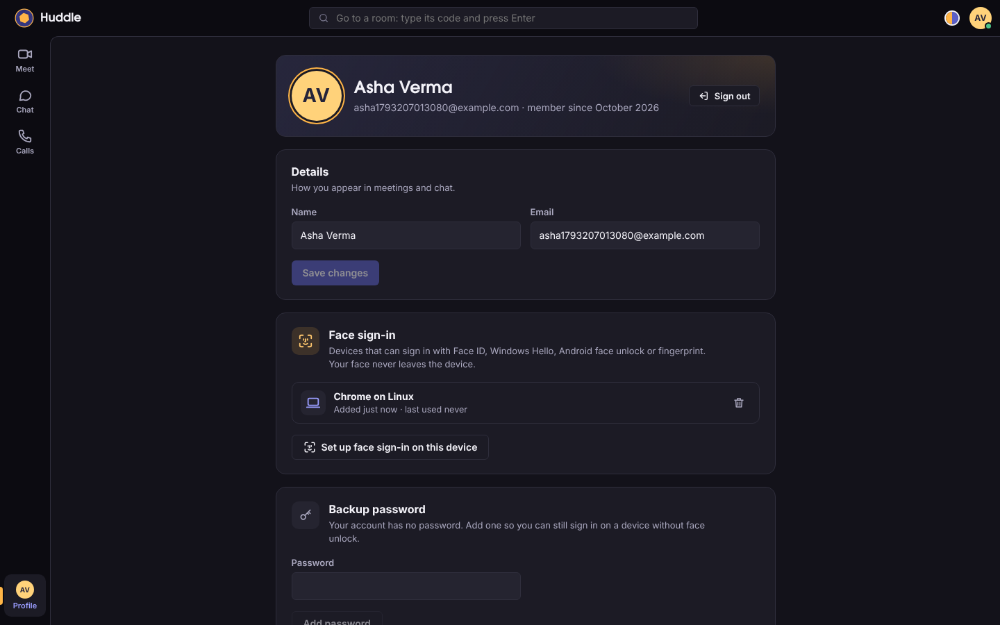
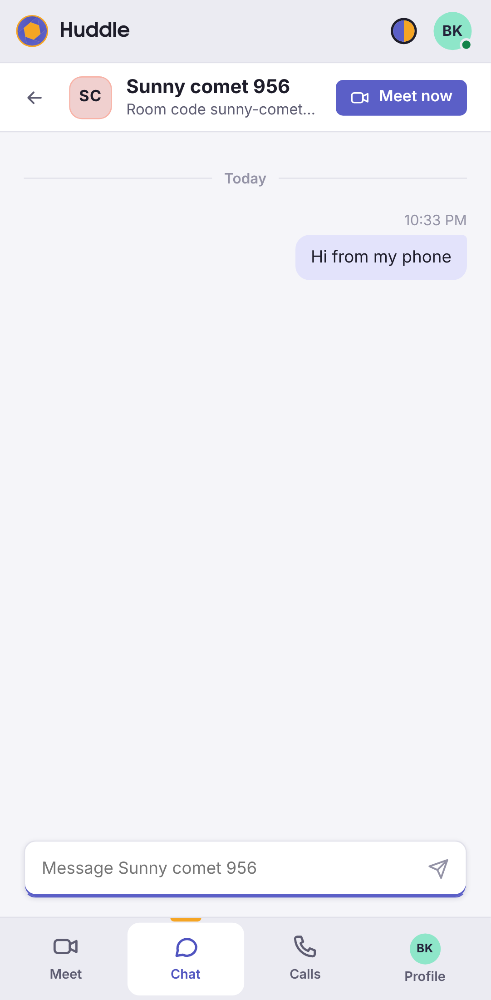

# Huddle: group video meetings with chat (React · React Native · Node.js · MongoDB)

Private group video meetings for up to 10 people, on **web, Android and iOS**,
built from scratch on **WebRTC** — now wrapped in a **professional network** with
a Facebook-style home feed, profiles, connections, direct messages and
admin-managed ads. You **sign in with your email and password**, or with
**Google or GitHub**, and an **admin dashboard** lets an administrator manage
accounts and the ads shown in the feed. No paid video vendor is involved: the
Node.js server only introduces people to each other, and audio and video flow
directly between devices.

The web app is laid out like a social network: a top bar with **one search for
posts and people** plus Messages and connection-request shortcuts, a left rail
(**Home, Network, Messages, Meet**, and Admin/Logs for admins), and a centered
feed with a "people you may know" and sponsored sidebar.

> **▶ Live demo: [harish007.duckdns.org](https://harish007.duckdns.org)**
> Create an account and start a meeting. It's best with two
> devices — open it on your phone too (on mobile data) and join the same code.



*A quick tour — start a meeting, share your screen and chat, all in one place.*

| Meet (dark) | Meet (light) |
|---|---|
|  |  |

| In a meeting, with chat | Screen share |
|---|---|
|  |  |

| Chat tab | Calls tab | Profile | Phone |
|---|---|---|---|
|  |  |  |  |

*(Screenshots come from automated tests that use Chrome's fake camera, so the videos show green test patterns.)*

## Put it online

**[DEPLOY.md](./DEPLOY.md)**: rent a small server, get a free DuckDNS address, run one
script. You get HTTPS, MongoDB, a TURN relay for calls on any network, and nightly
backups. The website can be added to a phone's home screen like an app.

The live instance above runs this exact stack on an **AWS Lightsail** (Ubuntu)
server, with HTTPS at [harish007.duckdns.org](https://harish007.duckdns.org).

## Accounts, sign-in and the admin dashboard

- **Email and password.** Passwords are hashed with **scrypt** and never stored
  in the clear; sessions are **JWTs** (7 days by default). Sign-up checks the
  email format and password strength, and failed logins are rate-limited.
- **Google, GitHub and Facebook (optional).** Set the matching client id and
  secret in the server environment and the sign-in page shows each configured button.
  The server runs the OAuth 2.0 authorization-code flow itself (no third-party
  library, `server/src/auth/oauth.js`); a social account is matched to an existing
  one by its provider ID or the email returned by the provider. Register the exact
  callback `https://<your-domain>/api/auth/oauth/<provider>/callback` with each
  provider. For local Google login, register
  `http://localhost:5173/api/auth/oauth/google/callback` as an authorized redirect
  URI. Keep provider secrets in `server/.env` locally or `deploy/.env` in production.
  With credentials missing, the corresponding button is hidden.
- **Admin dashboard.** An account with the **admin** role gets an **Admin** tab
  that lists everyone who has registered, with full create / edit / delete and
  the ability to change a user's role, plus an **Ads Manager** for the promo cards
  shown in the feed. On first start the server seeds an admin account from
  `ADMIN_EMAIL` / `ADMIN_PASSWORD` (default **admin / admin** — change the password
  before going live) and gives it a social profile so it can be connected to and
  messaged like anyone else. Admins can't delete themselves or drop their own admin
  role, so you can't lock yourself out.
- **Demo data.** `node server/src/seed.js` (or `docker compose exec app node
  server/src/seed.js`) fills the network with 30 sample users, profiles, photos
  and posts so the feed isn't empty — handy for a demo.

## The professional network

Huddle grew from a video-call app into a **professional network where job seekers
find mentors and guidance** — the **server, web UI and tests are in place**:

- **Professional profiles & CV** — photo, headline, bio, location, skills, experience,
  education, mobile, and a CV upload. A **partial profile** (photo, name, headline, skills)
  is visible to anyone; private details (mobile, CV, full experience) unlock only after a
  connection is **accepted**. The CV is downloadable by accepted connections.
- **Connections** — request, accept or decline; connections unlock full profiles and messaging.
  A **pending-request badge** sits in the top bar, and someone you've already requested is
  hidden from people search.
- **Facebook-style home feed** — the Feed and People pages are merged into one centered Home.
  Post text and a photo, like, **comment**, **edit** and **delete** your own posts and comments;
  click any post author to open their profile. A sidebar shows **People you may know** (with
  Connect buttons) and **Sponsored** ads.
- **One unified search** in the top bar searches **posts and people together**.
- **Direct messages** — 1:1 chat between connected users; the Messages page lists your
  connections ("people you know") so you can start a conversation, and you can jump straight
  into a **live video call** from a thread.
- **Admin-managed ads** — admins create/edit/delete promo cards (title, body, link, image,
  active toggle) in the dashboard; active ones render in every member's feed.
- **Your profile photo shows everywhere** — top bar, rail and feed composer update the moment
  you upload a new one.

### Design

- **Static media folder (default).** Uploads (photos, CVs, post images) are written to an
  `uploads/` folder and served from a **stable `/media/<key>` URL** that never expires, so
  images keep working in the UI indefinitely. The folder is a Docker volume in production, so
  files survive restarts. Uploads use short-lived **signed PUTs**; a 10 MB limit and file-type
  checks are enforced.
- **Amazon S3 (optional).** Set `S3_BUCKET`/`AWS_*` and uploads go straight to S3 via presigned
  URLs instead of the local folder — configure the bucket's CORS to allow `PUT` from your app's
  HTTPS origin.
- **Partial visibility is enforced on the server** — every profile response is shaped by the
  viewer's connection state, so private fields are never sent to strangers.
- **Reuse over rebuild.** The mentorship session is the existing WebRTC call; direct messages
  extend the chat system; accounts, roles and the admin dashboard carry over unchanged.
- **Data** lives in MongoDB collections: `profiles`, `connections`, `posts`, `dms`, `ads`.
  Deleting a user cascades to their profile, connections, posts and DMs.

## Design: Teams, with a lens

- **Layout like a social network:** a top bar with **one search for posts and
  people** (plus Messages and connection-request shortcuts), a left **app rail**
  (Home, Network, Messages, Meet — Admin and Logs for admins), a centered feed,
  and the meeting stage. On phones the rail becomes a bottom tab bar.
- **Meetings like Teams:** a top bar with Chat, People, Camera, Mic, Share and a
  red **Leave** button; chat and people open as side panels.
- **The creative part:** a calm **indigo** for actions and a warm **amber
  "spark"** for anything live or selected (the active rail marker, the
  speaking ring around a video tile, the "You joined" line). The six-blade
  **camera aperture** is the logo; it closes over your preview when your
  camera is off.
- **Dark and light mode:** follows your device until you pick one with the
  half-amber, half-indigo toggle. Headings use TeX Gyre Adventor; body text
  uses Segoe UI (like Teams) or the system font.

## Features

**Accounts**
- Sign in with **email and password**, or with **Google or GitHub** (optional social login)
- **Admin dashboard** (admin role): see everyone who has registered, and create, edit, delete or re-role accounts
- A social account can add a password in Profile, so it can also sign in by email
- Accounts in **MongoDB** with **scrypt**-hashed passwords; **JWT** sessions (7 days by default)
- Rate limiting, identical errors for "wrong password" and "no such account", invite links that survive sign-in
- **Profile**: change your name, email and password (changing the password signs out your other devices)

**Meet**
- Pre-join stage with camera preview and camera/mic switches, shows who is already in the meeting
- "Start a meeting now", join with a code, **Happening now** (your rooms with people in them), recent rooms
- Group meetings up to 10 people, speaking indicator, mute / camera-off shown to everyone
- Screen sharing (desktop web) with a spotlight layout, People panel with the invite link
- Recovers on its own: automatic reconnect, ICE restart, audio-only fallback

**Chat**
- Every room has a chat saved for 30 days. Read it and reply **from the Chat tab without joining the meeting**; people in the meeting see your message live
- In the meeting: "You joined" marker, load earlier messages, day dividers, unread badge

**Calls**
- Your call history: room, who was there, when, how long, and **Call again**

**Network, feed & messages**
- **Profiles** with photo, headline, bio, skills, experience, education and a CV; private fields unlock only for accepted connections
- **Connections**: request / accept / decline, a top-bar pending-request badge, and "People you may know" with Connect buttons
- **Home feed**: post text + photo, like, comment, edit and delete; click an author to view their profile; infinite scroll
- **One search** for posts and people; **direct messages** between connections with a live-video-call button
- **Ads**: admins manage promo cards in the dashboard; active ads appear in the member feed
- **Uploads** (photos, CVs, post images) served from a stable `/media/...` URL, or Amazon S3 when configured

## Project layout

```
video-call-app/
├── shared/   @vca/shared  — protocol, CallClient (WebRTC engine) and API client, used by web AND mobile
├── server/   @vca/server  — Node.js: auth (JWT), MongoDB users, rooms, WebSocket signaling, chat
├── web/      @vca/web     — React 19 + Vite + TypeScript
├── mobile/   @vca/mobile  — React Native (Expo dev build) + react-native-webrtc
├── docker-compose.yml     — local MongoDB for development
├── Dockerfile             — production image (web build + Node server)
├── deploy/                — production stack: Caddy (HTTPS), MongoDB, coturn, backups, setup.sh
└── docs/                  — screenshots
```

See **[ARCHITECTURE.md](./ARCHITECTURE.md)** for diagrams of the system, the sign-in flow and the call flow.

## Quick start (web)

Requires **Node.js 20+**. For MongoDB, use Docker or a free MongoDB Atlas cluster.

```bash
npm install
npm run db            # starts MongoDB in Docker on localhost:27017
```

Create `server/.env` (copy `server/.env.example`) and set:

```bash
MONGODB_URI=mongodb://localhost:27017
JWT_SECRET=<paste output of: node -e "console.log(require('crypto').randomBytes(48).toString('base64url'))">
```

Then:

```bash
npm run dev
```

- Web app: **http://localhost:5173**. Create an account with your email and password, then start a meeting.
- Server: **http://localhost:3001** (`/health` shows whether MongoDB is connected).

Open a second browser (or a private window), create another account, and join
the same room code.

> **No MongoDB yet?** Leave `MONGODB_URI` empty and the dev server runs with a
> temporary in-memory store. It prints a warning, and accounts disappear when
> the server restarts. Production refuses to start without MongoDB and a real
> `JWT_SECRET`.

> **Camera from another device:** browsers only allow camera/mic on `https://`
> or `localhost`. Use the mobile app, or put the site behind HTTPS (Step 2).

### Production

```bash
npm run build                         # builds web/dist
NODE_ENV=production MONGODB_URI=... JWT_SECRET=... npm start
```

The Node server serves the web app, the API and the WebSocket on one port.

## Mobile app (Android & iOS)

WebRTC needs native code, so this runs as an **Expo development build**. It
won't work in the Expo Go app.

```bash
npm install
cd mobile
npx expo install --fix         # align native package versions with your Expo SDK
cp .env.example .env           # set EXPO_PUBLIC_SIGNALING_URL to your computer's LAN IP
npx expo run:android           # or: npx expo run:ios   (needs Android Studio / Xcode)
```

Face sign-in in the app uses the phone's own Face ID / face unlock / fingerprint
(`expo-local-authentication` + `expo-secure-store`); turn it on when you create
an account, or later in Profile.

Keep `npm run dev:server` running on your computer. Phone and computer must be
on the same Wi-Fi, and the server prints the address to use. Use a **real
device**: emulators/simulators have no real camera. No Android Studio or Xcode?
Build in the cloud: `npx eas build --profile development --platform android`.

## API

| Method | Path | Auth | Body → Response |
|---|---|---|---|
| POST | `/api/auth/register` | — | `{ name, email, password }` → `201 { user, token, expiresAt }` |
| POST | `/api/auth/login` | — | `{ email, password }` → `200 { user, token, expiresAt }` |
| GET | `/api/auth/me` | Bearer | → `{ user }` |
| PATCH | `/api/auth/me` | Bearer | `{ name?, email?, currentPassword? }` → `{ user, token, expiresAt }` (email change needs `currentPassword`) |
| POST | `/api/auth/password` | Bearer | `{ currentPassword, newPassword }` → `{ user, token, expiresAt }`; older tokens stop working. Social-login accounts with no password yet send just `newPassword` to add one |
| GET | `/api/auth/providers` | — | → `{ providers: { google, github, facebook } }` (which social buttons to show) |
| GET | `/api/auth/oauth/:provider/start` | — | Redirects to Google, GitHub or Facebook (`provider` = `google`, `github` or `facebook`) |
| GET | `/api/auth/oauth/:provider/callback` | — | Provider returns here; redirects to the app with a token in the URL hash |
| GET | `/api/admin/users` | Bearer (admin) | → `{ users, total }` |
| POST | `/api/admin/users` | Bearer (admin) | `{ name, email, password, role? }` → `201 { user }` |
| PATCH | `/api/admin/users/:id` | Bearer (admin) | `{ name?, email?, role?, password? }` → `{ user }` |
| DELETE | `/api/admin/users/:id` | Bearer (admin) | → `{ ok, id }` (cascades to their social data; you can't delete yourself) |
| GET | `/api/admin/ads` | Bearer (admin) | → `{ ads }` (all ads) |
| POST | `/api/admin/ads` | Bearer (admin) | `{ title, body?, linkUrl?, imageKey?, active? }` → `201 { ad }` |
| PATCH | `/api/admin/ads/:id` | Bearer (admin) | ad fields → `{ ad }` |
| DELETE | `/api/admin/ads/:id` | Bearer (admin) | → `{ ok, id }` |
| GET | `/api/rooms/:id` | Bearer | → `{ roomId, participants, people, maxPeers, full }` |
| POST | `/api/rooms/:id/messages` | Bearer | `{ text }` → `201 { message }`; also sent live to people in the meeting |
| GET | `/api/chats` | Bearer | → `{ chats }`: your rooms, last message, who's in the meeting now |
| GET | `/api/calls` | Bearer | → `{ calls }`: room, with whom, start, end, duration |
| GET | `/api/rooms/:id/messages?before=<ts>&limit=50` | Bearer | → `{ messages, hasMore }` (oldest first; for "Load earlier") |
| GET | `/health` | — | → `{ ok, db, store, rooms, participants }` |
| WS | `/ws` | token in `join` | signaling, see ARCHITECTURE.md |

Errors are `{ error, code?, fields? }`. `fields` holds per-field messages for
forms (e.g. `{ email: "Already registered…" }`).

### Professional network API

All require a Bearer token. Profile responses are shaped by the viewer's connection state.

| Method | Path | Body → Response |
|---|---|---|
| GET | `/api/profile/me` | → `{ profile }` (your full profile) |
| PUT | `/api/profile` | profile fields → `{ profile }` |
| GET | `/api/profile/:userId` | → `{ profile, posts }` (partial unless connected) |
| GET | `/api/people?q=&role=&page=&limit=` | → `{ people, page, limit, total }` (search; `role` = `mentor`/`mentee`; excludes pending requests) |
| POST | `/api/media/upload-url` | `{ kind, contentType }` → `{ uploadUrl, key }` (`kind` = `photo`/`cv`/`post`; local signed PUT, or S3 presigned when configured) |
| GET | `/media/:key` | → the uploaded file, served statically (local mode; no signature, no expiry) |
| POST | `/api/connections/:userId/request` | → `{ status }` |
| POST | `/api/connections/:userId/accept` | → `{ status }` |
| POST | `/api/connections/:userId/decline` | → `{ status }` |
| GET | `/api/connections?page=&limit=` | → `{ connections, page, limit, total }` |
| GET | `/api/connections/requests` | → `{ requests }` (incoming) |
| POST | `/api/posts` | `{ text, imageKey? }` → `201 { post }` |
| GET | `/api/feed?before=<ts>` | → `{ posts }` (you + your connections) |
| GET | `/api/posts/search?q=&page=` | → `{ posts }` (full-text post search) |
| POST | `/api/posts/:id/like` | → `{ post }` (toggles) |
| POST | `/api/posts/:id/comments` | `{ text }` → `{ post }` |
| PATCH | `/api/posts/:id` | `{ text }` → `{ post }` (edit your own post) |
| DELETE | `/api/posts/:id` | → `{ ok }` (author or admin; also deletes the image file) |
| DELETE | `/api/posts/:postId/comments/:commentId` | → `{ post }` (comment author, post author or admin) |
| GET | `/api/ads` | → `{ ads }` (active ads for the feed) |
| GET | `/api/dm` | → `{ conversations }` |
| GET | `/api/dm/:userId?page=&limit=&before=` | → `{ messages }` (connections only) |
| POST | `/api/dm/:userId` | `{ text }` → `201 { message }` (connections only) |

## Scripts

| Command | What it does |
|---|---|
| `npm run dev` | server + web with hot reload |
| `npm run db` | start MongoDB in Docker |
| `npm run dev:server` / `dev:web` / `dev:mobile` | one at a time |
| `npm test` | server tests (auth, admin, ads, profiles/connections/posts/DMs, media, JWT, passwords, MongoDB stores, signaling, chat, calls) |
| `npm run build` | production web build |
| `npm start` | production server (serves `web/dist`) |

## Configuration

| Where | Variable | Default |
|---|---|---|
| server | `MONGODB_URI`, `MONGODB_DB` | in-memory in dev (required in prod), `huddle` |
| server | `JWT_SECRET`, `JWT_EXPIRES_IN` | dev-only secret (required in prod), `7d` |
| server | `ADMIN_EMAIL`, `ADMIN_PASSWORD`, `ADMIN_NAME` | `admin`, `admin`, `Administrator` — the seeded admin account (change the password before going live) |
| server | `APP_URL`, `GOOGLE_CLIENT_ID`/`_SECRET`, `GITHUB_CLIENT_ID`/`_SECRET`, `FACEBOOK_CLIENT_ID`/`_SECRET` | social login: public base URL for callbacks and provider credentials (unset → that button is hidden) |
| server | `LOCAL_MEDIA_DIR` | folder where photo/CV/post uploads are stored and served from `/media/...` (default `server/uploads/`; a Docker volume in production). Used whenever S3 is not configured |
| server | `AWS_REGION`, `S3_BUCKET`, `AWS_ACCESS_KEY_ID`, `AWS_SECRET_ACCESS_KEY` | optional: send uploads to Amazon S3 instead of the local folder; configure bucket CORS to allow `PUT` from your app's origin |
| server | `TURN_URLS`, `TURN_SECRET`, `TURN_TTL_SEC`, `STUN_URLS` | no TURN, `12h` credentials, Google STUN (set by `deploy/` automatically) |
| server | `CHAT_RETENTION_DAYS` | `30` (MongoDB deletes older messages on its own) |
| server | `PORT`, `HOST`, `MAX_PEERS`, `ALLOWED_ORIGINS`, `TRUST_PROXY`, `WEB_DIST` | `3001`, `0.0.0.0`, `10`, `*`, `false`, `../web/dist` |
| web | `VITE_API_URL`, `VITE_SIGNALING_URL`, `VITE_ICE_SERVERS` | same origin, same host `/ws`, Google STUN |
| mobile | `EXPO_PUBLIC_SIGNALING_URL`, `EXPO_PUBLIC_ICE_SERVERS` | — (set your LAN IP), Google STUN |

Each folder has a `.env.example`.

## What's tested

- **Server:**
  - **Accounts & admin:** register / sign-in validation, duplicate emails, new accounts defaulting to the `user` role, the social-providers endpoint, and the admin API — list, create, update and delete users, role changes, and the guards that stop an admin from deleting or demoting themselves.
  - **Professional network:** profiles and partial visibility, connections (request / accept / decline / remove, idempotent requests), posts & feed (create, like, comment, before-paging), direct messages (connections only), and a regression test that a **profile-less account like the seeded admin can still receive and accept connection requests**.
  - **Ads:** admin create / edit / delete, and that only *active* ads reach members' feeds.
  - **Media:** local uploads saved and served from the static `/media/...` URL (no signature, no expiry), with path-traversal and bad-key rejections, content-type and 10 MB limits.
  - JWT tampering, expiry, wrong key or audience, and `alg: none`; salted password hashes; sign-up/sign-in validation, duplicate emails, rate limits.
  - Meetings: a token is required, names can't be spoofed, room cap, relay, chat, mute state.
  - Profile changes; saved chat (history, paging, retention); Chat and Calls tabs (last message, who's in the meeting, sending from outside a meeting reaches people inside, call history with names).
  - TURN credentials (coturn REST scheme, expiry, sent on join) and production config checks.
  - MongoDB stores (users, chat, calls) against fake collections. Set `MONGODB_URI` to run against a real database.
- **Web, end to end in Chromium:** register and sign in with email and password, then a two-person meeting (pre-join shows who's there, unread badge, People panel), the Chat tab (live marker, a message from the tab reaches the meeting), the Calls tab, the dark/light toggle, and the phone layout (bottom tabs, no sideways scrolling).
- **3-person meeting (3 checks):** everyone sees everyone, chat, screen-share spotlight.
- **CI on GitHub** (`.github/workflows/ci.yml`): server tests, web typecheck and build, and the production Docker image built and started on every push.
- **Mobile:** written against `react-native-webrtc`, `expo-secure-store` and `expo-local-authentication`, and syntax-checked. It still needs a first run on a real phone (Face ID needs a device, not a simulator).

## Roadmap

- [x] Step 1: 1-to-1 web call
- [x] Full app: React web + React Native mobile + Node server, group calls, chat, screen share
- [x] **Accounts**: MongoDB + JWT, sign-in / sign-up on web and mobile
- [x] **Step 2**: deployment with HTTPS, TURN (coturn) with short-lived credentials, MongoDB backups ([DEPLOY.md](./DEPLOY.md))
- [x] Profile editing and saved call chat (web + mobile)
- [x] **Email + password and social login** (Google / GitHub / Facebook), an **admin dashboard** with user management, and a Teams-style layout with Chat and Calls tabs
- [x] **Professional network**: profiles + CV, connections with partial visibility, a merged Facebook-style home feed with unified post/people search, **direct messages**, admin-managed **ads**, and static-folder media uploads
- [ ] Forgot-password email, refresh tokens
- [ ] **Step 3**: SFU (mediasoup) for bigger rooms (10–20+)
