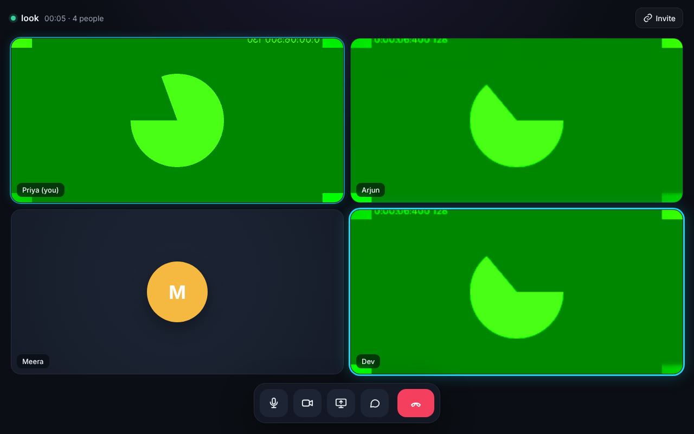
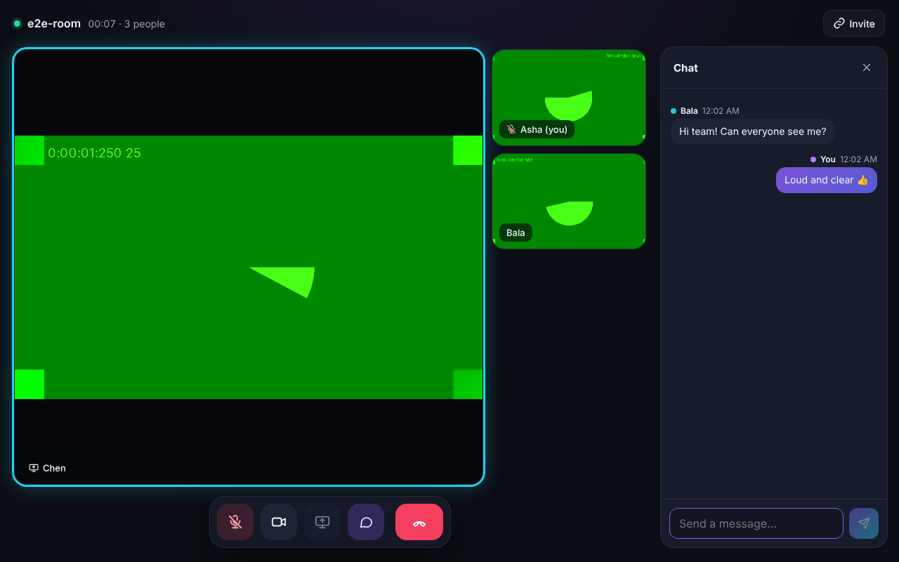
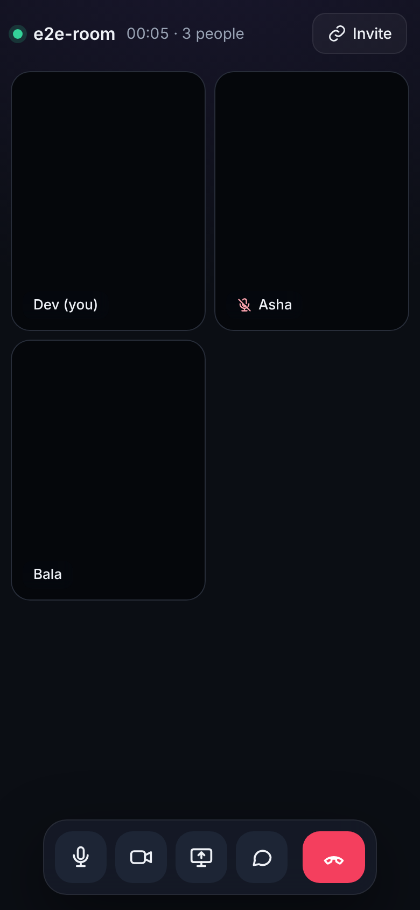

# Huddle — group video calls (React · React Native · Node.js)

Private group video calls for up to 6 people, on **web, Android and iOS**, built
from scratch on **WebRTC**. No paid video vendor: the Node.js server only
introduces people to each other; audio and video flow directly between devices.


| Lobby | 4-person call | Screen share | Phone browser |
|---|---|---|---|
|  |  |  |  |

*(Screenshots come from automated tests that use Chrome's fake camera, so the videos show green test patterns.)*

## Features

- **Group calls** up to 6 people (adaptive grid, configurable cap)
- **Lobby** with camera preview, mic/camera toggles, and a live "N people in this room" check
- **Room codes and invite links** (`/r/swift-comet-482`)
- **Mute / camera off** shown to everyone, with avatars when the camera is off
- **Speaking indicator** (glowing ring) on web
- **Screen sharing** on desktop web, with an automatic spotlight layout
- **Live chat** with an unread badge
- **Mobile app**: front/back camera flip and a native share sheet for invites
- **Resilient**: works without a camera (audio-only fallback), reconnects automatically, retries failed connections (ICE restart), validates every message on the server, limits chat floods

## Project layout

```
video-call-app/
├── shared/   @vca/shared  — signaling protocol + CallClient (the WebRTC engine used by web AND mobile)
├── server/   @vca/server  — Node.js + ws: rooms, signaling relay, chat, REST, serves the web build
├── web/      @vca/web     — React 19 + Vite + TypeScript
├── mobile/   @vca/mobile  — React Native (Expo dev build) + react-native-webrtc
└── docs/                  — architecture, mockups, screenshots
```

See **[ARCHITECTURE.md](./ARCHITECTURE.md)** for diagrams of how it all fits together.

## Quick start (web)

Requires **Node.js 20+**.

```bash
npm install
npm run dev
```

- Web app: **http://localhost:5173** (Vite, hot reload)
- Server: **http://localhost:3001** (WebSocket at `/ws`)

Open the web app in two browser windows (or two devices on your Wi-Fi), enter the
same room code, and join.

> **Testing from another device on your network:** camera and mic only work on
> `https://` or `localhost`. Phone browsers reaching `http://192.168.x.x:5173`
> will join audio/video-less. Use the mobile app, or put the site behind HTTPS
> (Step 2).

### Production build

```bash
npm run build      # builds web/dist
npm start          # Node serves the web app + WebSocket on :3001
```

## Mobile app (Android & iOS)

WebRTC needs native code, so this runs as an **Expo development build**. It
won't work in the Expo Go app.

```bash
npm install
cd mobile
npx expo install --fix         # align native package versions with your Expo SDK
cp .env.example .env           # set EXPO_PUBLIC_SIGNALING_URL to your computer's LAN IP
npx expo run:android           # or: npx expo run:ios   (needs Android Studio / Xcode)
```

Then keep `npm run dev:server` running on your computer. Phone and computer must
be on the same Wi-Fi, and the server prints the address to use. Use a **real
device**: emulators/simulators have no real camera.

No Android Studio or Xcode? Build in the cloud with EAS:
`npx eas build --profile development --platform android`.

## Scripts

| Command | What it does |
|---|---|
| `npm run dev` | server + web with hot reload |
| `npm run dev:server` / `dev:web` / `dev:mobile` | one at a time |
| `npm test` | server integration tests (Node test runner) |
| `npm run build` | production web build |
| `npm start` | production server (serves `web/dist`) |

## Configuration

| Where | Variable | Default |
|---|---|---|
| server | `PORT`, `HOST`, `MAX_PEERS`, `ALLOWED_ORIGINS`, `WEB_DIST` | `3001`, `0.0.0.0`, `6`, `*`, `../web/dist` |
| web | `VITE_SIGNALING_URL`, `VITE_ICE_SERVERS` | same host `/ws`, Google STUN |
| mobile | `EXPO_PUBLIC_SIGNALING_URL`, `EXPO_PUBLIC_ICE_SERVERS` | — (set your LAN IP), Google STUN |

Each folder has a `.env.example`.

## What's tested

- **Server**: 9 integration tests covering joining, targeted signal relay, room cap, leave, chat, media state, input validation, chat throttling and `/health`.
- **Web, end to end**: 3 real Chromium users with fake cameras join one room and get live audio and video from each other. The test also checks mute, camera off/on, chat and the unread badge, screen share with the spotlight layout, leaving, and the "room is full" message for a 7th person.
- **Mobile**: code is written against `react-native-webrtc` and syntax-checked. It still needs a first run on a real device.

## Roadmap

- [x] Step 1: 1-to-1 web call
- [x] **Full app**: React web + React Native mobile + Node server, group calls (mesh, ≤6), chat, screen share
- [ ] **Step 2**: TURN server (coturn) + HTTPS/WSS, so calls work across any network
- [ ] **Step 3**: SFU (mediasoup) for bigger rooms (10–20+)
- [ ] **Step 4**: accounts, scheduled rooms, push notifications for incoming calls
