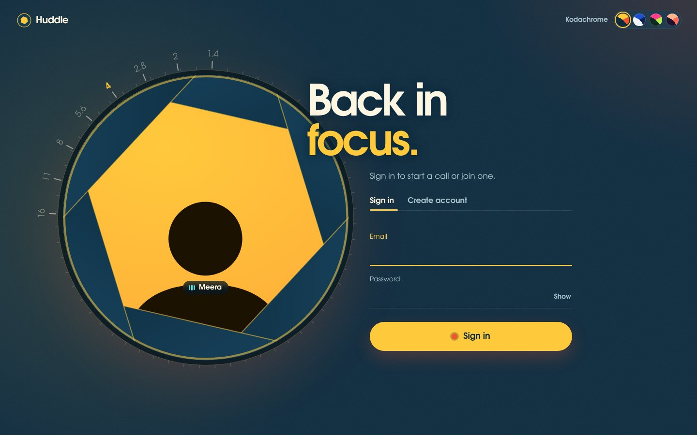
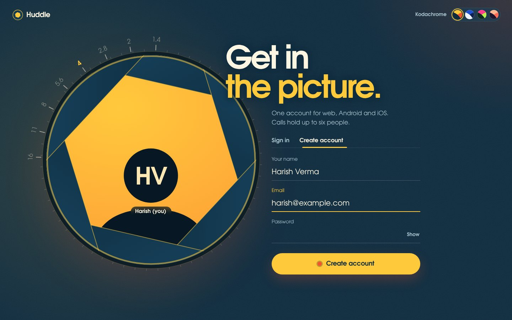
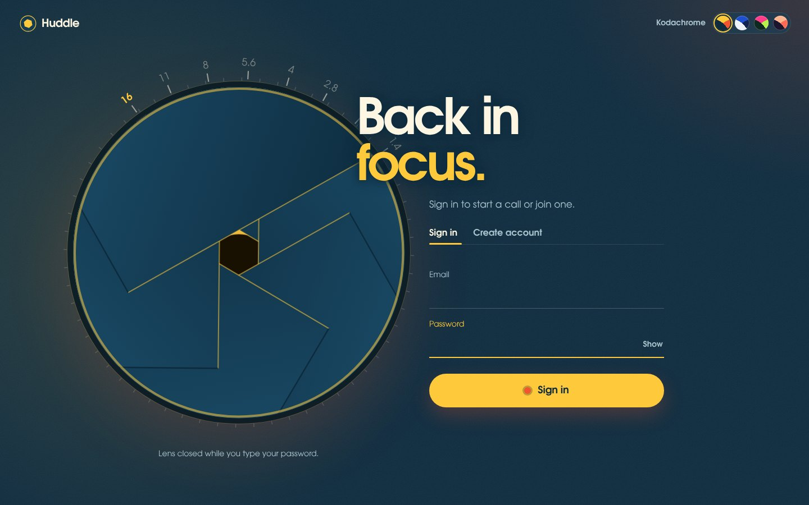
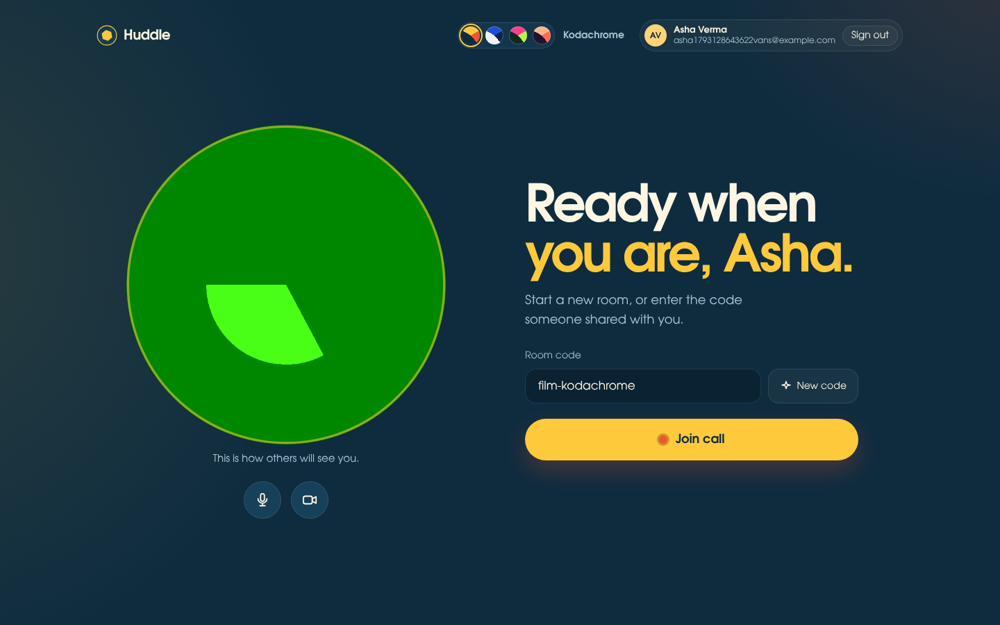
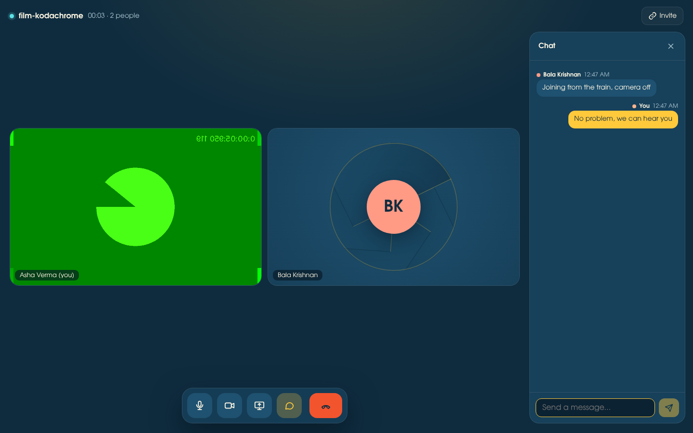
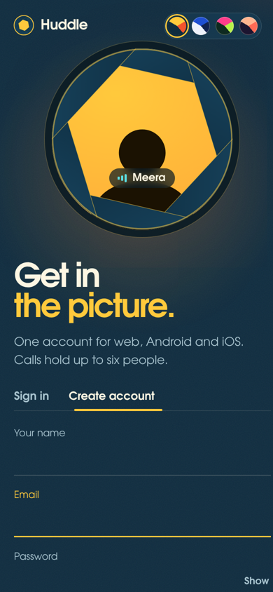
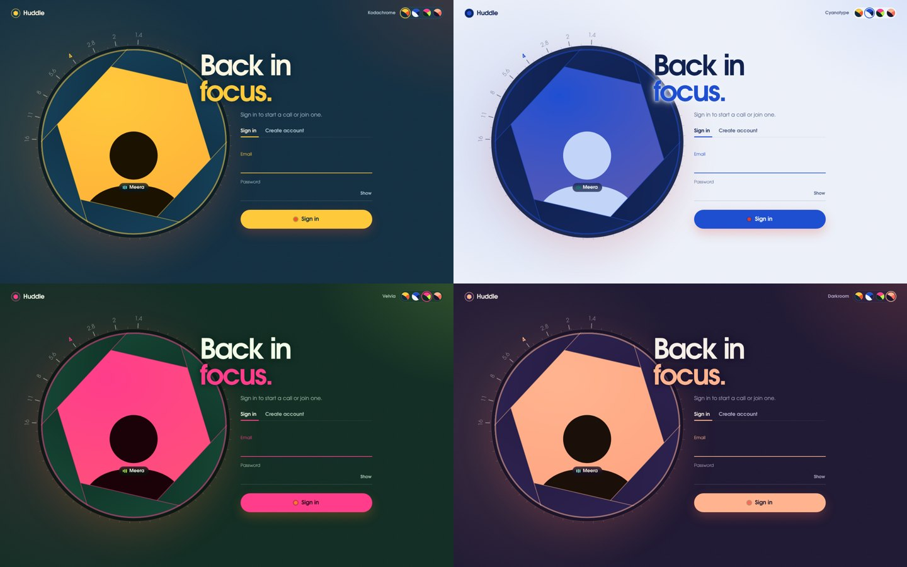
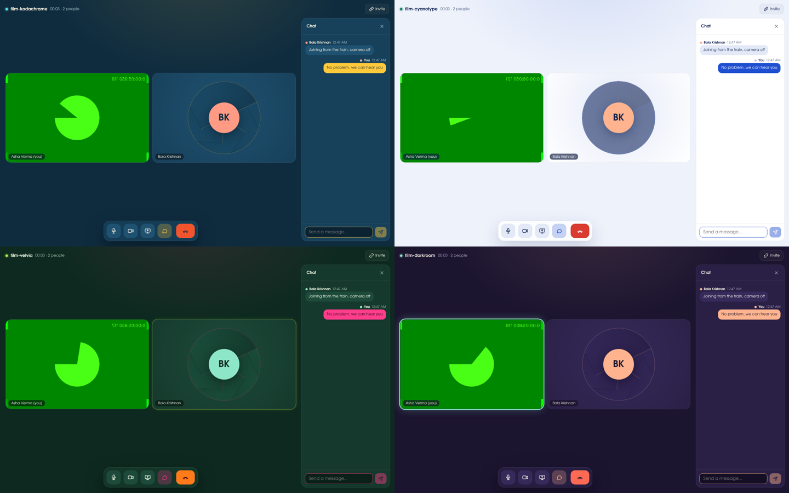

# Huddle: group video calls (React · React Native · Node.js · MongoDB)

Private group video calls for up to 6 people, on **web, Android and iOS**, built
from scratch on **WebRTC**. People sign in with an account stored in **MongoDB**
and authenticated with **JWT**. No paid video vendor is involved: the Node.js
server only introduces people to each other, and audio and video flow directly
between devices.



| Your name appears in the lens | Lens shuts for your password | Lobby | Call with chat | Phone |
|---|---|---|---|---|
|  |  |  |  |  |

## Design: "the lens opens"

The whole app is built around one object from the world of video: a **camera
aperture**. Its six blades open, close and twist like a real iris, and they
respond to what you do instead of looping for decoration:

| When you… | The lens… |
|---|---|
| open the sign-in page | opens from shut, and the aperture scale on the barrel turns to match (f/16 → f/4) |
| click into the password field | **closes**, so the lens never peeks while you type it |
| type your name when signing up | shows your initials inside, the way others will see you before your camera starts |
| make a mistake | blinks shut and open, like a shutter |
| sign in | opens wide, and the lobby appears through an expanding circle |
| turn your camera off in the lobby | closes over your preview |
| are in a call with your camera off | your tile shows a shut iris behind your initials |
| pick a different film stock | closes, the colours swap behind it, and it opens again |

### Film stocks: four colour palettes

The colours come from four palettes named after real photographic processes.
Pick one with the round swatches in the top corner of the sign-in page or the
lobby header (arrow keys work too). Your choice is remembered on that device.

| Film | Feel | Colours |
|---|---|---|
| **Kodachrome** (default) | warm, confident 1970s colour film | teal-blue `#0F2C3F` · sunflower `#FFC93C` · tomato `#F2542D` · aqua `#5CE1E6` · cream `#FDF6E3` |
| **Cyanotype** (light) | a blueprint print | paper `#EEF2FB` · Prussian blue `#1F4FD1` · ink navy `#112250` |
| **Velvia** | bold, saturated slide film | forest `#0E2A20` · magenta `#FF3D8B` · lime `#B6F24A` · orange `#FF7A1A` |
| **Darkroom** | moody | aubergine `#1C1530` · lens-flare peach `#FFB48F` · coral `#FF6A55` · mint `#8EE6C9` |




Every palette passes WCAG AA contrast for body text, muted text, button labels
and error messages (checked numerically, from 4.4:1 up to 15:1).
Each palette defines the same colour roles (background, surface, text,
accent, "hot" for live and leave, "cool" for connected and speaking, and so on)
in `web/src/styles.css`, so a new film stock is one CSS block.

**Type:** TeX Gyre Adventor, a free revival of the geometric face used in 1970s
broadcast design, shipped with the app under the GUST Font License (`web/public/fonts`).
All motion stops when the system "reduce motion" setting is on.

*(Screenshots come from automated tests that use Chrome's fake camera, so the videos show green test patterns.)*

## Features

**Accounts**
- Sign in / create account page built around the animated aperture (above), with a sliding Sign in / Create account switch, a show-password toggle, a Caps Lock warning and a live password-strength meter
- Accounts in **MongoDB** (unique, case-insensitive email) with **scrypt**-hashed passwords
- **JWT** sessions (7 days by default), sent on every API call and on joining a call. Your name in a call comes from your account and can't be spoofed.
- Login rate limiting, identical errors for "wrong password" and "no such account" (so people can't probe which emails are registered), invite links that survive sign-in
- Web keeps the session in localStorage. Mobile keeps it in the **OS keychain/keystore** (expo-secure-store).

**Calls**
- Group calls up to 6 people, adaptive grid, speaking indicator
- Lobby with camera preview, mic/camera toggles, and a live "N people in this room" check
- Room codes and invite links (`/r/swift-comet-482`)
- Mute / camera-off shown to everyone, with avatars when the camera is off
- Screen sharing (desktop web) with a spotlight layout, live chat with an unread badge
- Mobile: front/back camera flip and a native share sheet for invites
- Recovers on its own: automatic reconnect, retrying failed connections (ICE restart), audio-only fallback

## Project layout

```
video-call-app/
├── shared/   @vca/shared  — protocol, CallClient (WebRTC engine) and API client, used by web AND mobile
├── server/   @vca/server  — Node.js: auth (JWT), MongoDB users, rooms, WebSocket signaling, chat
├── web/      @vca/web     — React 19 + Vite + TypeScript
├── mobile/   @vca/mobile  — React Native (Expo dev build) + react-native-webrtc
├── docker-compose.yml     — local MongoDB
└── docs/                  — architecture, mockups, screenshots
```

See **[ARCHITECTURE.md](./ARCHITECTURE.md)** for diagrams of the system, the sign-in flow and the call flow.

## Quick start (web)

Requires **Node.js 20+**. For MongoDB, use Docker or a free MongoDB Atlas cluster.

```bash
npm install
npm run db            # starts MongoDB in Docker on localhost:27017
```

Create `server/.env` (copy `server/.env.example`) and set:

```bash
MONGODB_URI=mongodb://localhost:27017
JWT_SECRET=<paste output of: node -e "console.log(require('crypto').randomBytes(48).toString('base64url'))">
```

Then:

```bash
npm run dev
```

- Web app: **http://localhost:5173**. Create an account, then start a call.
- Server: **http://localhost:3001** (`/health` shows whether MongoDB is connected).

Open a second browser (or a private window), create another account, and join
the same room code.

> **No MongoDB yet?** Leave `MONGODB_URI` empty and the dev server runs with a
> temporary in-memory store. It prints a warning, and accounts disappear when
> the server restarts. Production refuses to start without MongoDB and a real
> `JWT_SECRET`.

> **Camera from another device:** browsers only allow camera/mic on `https://`
> or `localhost`. Use the mobile app, or put the site behind HTTPS (Step 2).

### Production

```bash
npm run build                         # builds web/dist
NODE_ENV=production MONGODB_URI=... JWT_SECRET=... npm start
```

The Node server serves the web app, the API and the WebSocket on one port.

## Mobile app (Android & iOS)

WebRTC needs native code, so this runs as an **Expo development build**. It
won't work in the Expo Go app.

```bash
npm install
cd mobile
npx expo install --fix         # align native package versions with your Expo SDK
cp .env.example .env           # set EXPO_PUBLIC_SIGNALING_URL to your computer's LAN IP
npx expo run:android           # or: npx expo run:ios   (needs Android Studio / Xcode)
```

Keep `npm run dev:server` running on your computer. Phone and computer must be
on the same Wi-Fi, and the server prints the address to use. Use a **real
device**: emulators/simulators have no real camera. No Android Studio or Xcode?
Build in the cloud: `npx eas build --profile development --platform android`.

## API

| Method | Path | Auth | Body → Response |
|---|---|---|---|
| POST | `/api/auth/register` | — | `{ name, email, password }` → `201 { user, token, expiresAt }` |
| POST | `/api/auth/login` | — | `{ email, password }` → `200 { user, token, expiresAt }` |
| GET | `/api/auth/me` | Bearer | → `{ user }` |
| GET | `/api/rooms/:id` | Bearer | → `{ roomId, participants, maxPeers, full }` |
| GET | `/health` | — | → `{ ok, db, store, rooms, participants }` |
| WS | `/ws` | token in `join` | signaling, see ARCHITECTURE.md |

Errors are `{ error, code?, fields? }`. `fields` holds per-field messages for
forms (e.g. `{ email: "Already registered…" }`).

## Scripts

| Command | What it does |
|---|---|
| `npm run dev` | server + web with hot reload |
| `npm run db` | start MongoDB in Docker |
| `npm run dev:server` / `dev:web` / `dev:mobile` | one at a time |
| `npm test` | server tests (auth, JWT, passwords, MongoDB store, signaling) |
| `npm run build` | production web build |
| `npm start` | production server (serves `web/dist`) |

## Configuration

| Where | Variable | Default |
|---|---|---|
| server | `MONGODB_URI`, `MONGODB_DB` | in-memory in dev (required in prod), `huddle` |
| server | `JWT_SECRET`, `JWT_EXPIRES_IN` | dev-only secret (required in prod), `7d` |
| server | `PORT`, `HOST`, `MAX_PEERS`, `ALLOWED_ORIGINS`, `TRUST_PROXY`, `WEB_DIST` | `3001`, `0.0.0.0`, `6`, `*`, `false`, `../web/dist` |
| web | `VITE_API_URL`, `VITE_SIGNALING_URL`, `VITE_ICE_SERVERS` | same origin, same host `/ws`, Google STUN |
| mobile | `EXPO_PUBLIC_SIGNALING_URL`, `EXPO_PUBLIC_ICE_SERVERS` | — (set your LAN IP), Google STUN |

Each folder has a `.env.example`.

## What's tested

- **Server (23 tests):**
  - JWT: tampering, expiry, wrong key or audience, and the `alg: none` attack are all rejected.
  - Passwords: hashes are salted and verify correctly.
  - Sign-up and sign-in: field validation, duplicate emails (any letter case), the same error for wrong password and unknown email, rate limiting, and forged or orphaned tokens.
  - MongoDB user store: checked against a fake collection. Set `MONGODB_URI` to run the same test against a real database.
  - Calls: a token is required to join and the name can't be spoofed. Room cap, signal relay, chat and mute state all work.
- **Web, end to end in Chromium (24 checks):** the lens opens on load, closes for the password, reopens, blinks on a bad submit, shows your initials and opens wide on success. Also checked: sign-up validation and strength meter, register, refresh to stay signed in, sign out, wrong password, correct password, duplicate email, an invite link opened while signed out, rejection of a forged stored token, and live video calls between signed-in accounts (with chat and screen share in a 3-person call).
- **Mobile:** written against `react-native-webrtc` and `expo-secure-store`, and syntax-checked. It still needs a first run on a real device.

## Roadmap

- [x] Step 1: 1-to-1 web call
- [x] Full app: React web + React Native mobile + Node server, group calls, chat, screen share
- [x] **Accounts**: MongoDB + JWT, sign-in / sign-up on web and mobile
- [ ] **Step 2**: TURN server (coturn) + HTTPS/WSS, so calls work across any network
- [ ] Forgot-password email, profile editing, refresh tokens
- [ ] **Step 3**: SFU (mediasoup) for bigger rooms (10–20+)
